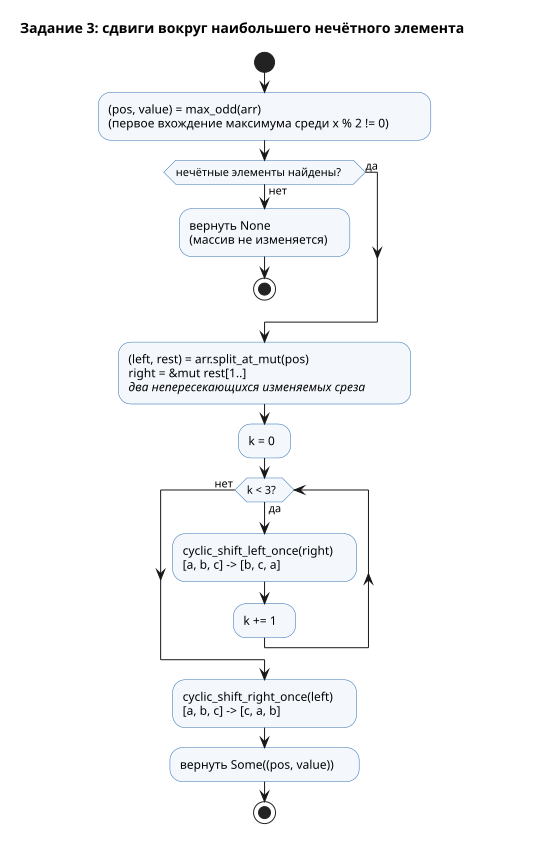

**Имя студента:** Цароев Альберт Казебкович\
**Группа:** ПИЖ-б-о-23-1(1)\
**Предмет:** Контейнерные технологии и DevOps для ИТ-специалистов\
**Претендую на оценку:** Отлично

# Лабораторная работа №1. Обработка массивов

## Цель работы

Освоить базовые конструкции языка (циклы, срезы, итераторы, обработку ошибок)
на примере задач обработки одномерных и двумерных массивов. Вместо языка Go
работа выполнена на Rust.

## Задание

1. Дан одномерный массив из N чисел. Заменить каждый элемент массива с нечётным
   индексом на ноль.
2. Дан двумерный массив размером M×N чисел. Посчитать сумму элементов в каждом
   столбце.
3. Дан одномерный массив из N чисел. Найти наибольший нечётный элемент. Далее
   трижды осуществить циклический сдвиг влево элементов, стоящих справа от
   найденного максимума, и один раз сдвиг вправо элементов, стоящих слева от
   найденного максимума.

## Ход работы

### Структура крейта

Все работы собраны в один Cargo-воркспейс; общие версии зависимостей задаются
в корневом `Cargo.toml`, а `cargo-hakari` поддерживает крейт `workspace-hack`,
который унифицирует набор features зависимостей и ускоряет инкрементальную
сборку всего воркспейса.

```text
lb1/
├── Cargo.toml
├── docs/task3_activity.puml   — диаграмма алгоритма задания 3
└── src/
    ├── lib.rs                 — реализация заданий и модульные тесты
    └── main.rs                — демонстрационная программа
```

Логика вынесена в библиотеку (`lib.rs`), чтобы её можно было покрыть тестами,
а `main.rs` только печатает результаты на фиксированных примерах.

### Задание 1. Обнуление элементов с нечётным индексом

```rust
pub fn zero_odd_indices<T: Default>(arr: &mut [T]) {
    for x in arr.iter_mut().skip(1).step_by(2) {
        *x = T::default();
    }
}
```

Функция принимает изменяемый срез `&mut [T]`, поэтому работает и с массивами
фиксированной длины, и с `Vec`. Итератор `iter_mut().skip(1).step_by(2)`
перебирает ровно элементы с индексами 1, 3, 5, … без ручной арифметики индексов
и проверок границ. Функция обобщённая: «нулём» считается `T::default()`, что для
всех числовых типов Rust (`i32`, `i64`, `f64`, …) равно `0`. Эквивалент на Go —
цикл `for i := 1; i < len(arr); i += 2 { arr[i] = 0 }`.

### Задание 2. Сумма элементов каждого столбца

Двумерный массив представлен структурой `Matrix`, которая хранит элементы
построчно в одном векторе. Конструктор проверяет, что все строки одинаковой
длины, поэтому «рваная» матрица не может появиться в программе:

```rust
impl Matrix {
    pub fn from_rows(rows: Vec<Vec<i64>>) -> Result<Self, MatrixError> {
        let cols = rows.first().map_or(0, Vec::len);
        let mut data = Vec::with_capacity(rows.len() * cols);
        for (i, row) in rows.iter().enumerate() {
            if row.len() != cols {
                return Err(MatrixError::Ragged {
                    row: i,
                    expected: cols,
                    found: row.len(),
                });
            }
            data.extend_from_slice(row);
        }
        Ok(Self { rows: rows.len(), cols, data })
    }

    pub fn column_sums(&self) -> Result<Vec<i64>, MatrixError> {
        let mut sums = vec![0_i64; self.cols];
        for row in self.iter_rows() {
            for (column, (acc, &x)) in sums.iter_mut().zip(row).enumerate() {
                *acc = acc.checked_add(x).ok_or(MatrixError::Overflow { column })?;
            }
        }
        Ok(sums)
    }
}
```

Строки обходятся по порядку (`chunks_exact`), что соответствует расположению
данных в памяти и дружелюбно к кэшу процессора. Сложение выполняется через
`checked_add`: при переполнении `i64` функция возвращает ошибку
`MatrixError::Overflow` с номером столбца, а не «заворачивает» значение, как это
молча сделал бы Go.

### Задание 3. Сдвиги вокруг наибольшего нечётного элемента

Алгоритм состоит из трёх шагов: найти максимум среди нечётных элементов, разбить
массив на части слева и справа от него и выполнить сдвиги.



```rust
pub fn max_odd(arr: &[i64]) -> Option<(usize, i64)> {
    arr.iter()
        .copied()
        .enumerate()
        .filter(|&(_, x)| x % 2 != 0)
        // `max_by_key` вернул бы последнее вхождение, поэтому сравниваем вручную.
        .fold(None, |best, (i, x)| match best {
            Some((_, b)) if b >= x => best,
            _ => Some((i, x)),
        })
}

pub fn cyclic_shift_left_once<T: Copy>(part: &mut [T]) {
    let Some(&first) = part.first() else { return };
    for i in 1..part.len() {
        part[i - 1] = part[i];
    }
    part[part.len() - 1] = first;
}

pub fn cyclic_shift_right_once<T: Copy>(part: &mut [T]) {
    let Some(&last) = part.last() else { return };
    for i in (1..part.len()).rev() {
        part[i] = part[i - 1];
    }
    part[0] = last;
}

pub fn shift_around_max_odd(arr: &mut [i64]) -> Option<(usize, i64)> {
    let (pos, value) = max_odd(arr)?;
    let (left, rest) = arr.split_at_mut(pos);
    let right = &mut rest[1..];

    for _ in 0..3 {
        cyclic_shift_left_once(right);
    }
    cyclic_shift_right_once(left);

    Some((pos, value))
}
```

Особенности реализации:

* Проверка нечётности `x % 2 != 0` корректна и для отрицательных чисел
  (`-3 % 2 == -1`).
* Отсутствие нечётных элементов — не ошибка программы, а штатный случай,
  поэтому результат имеет тип `Option`; оператор `?` сразу возвращает `None`,
  и массив остаётся без изменений.
* `split_at_mut` даёт два непересекающихся изменяемых среза. Компилятор
  гарантирует, что сдвиги частей не затронут сам максимум.
* Сдвиг выполняется буквально «трижды по одному» (`cyclic_shift_left_once`),
  как сказано в задании. В тестах результат сравнивается со стандартными
  `rotate_left(3 % len)` и `rotate_right(1)`.

Пример из программы: максимум `21` на индексе 4, левая часть
`[4, 15, 8, 2]` после сдвига вправо становится `[2, 4, 15, 8]`, правая часть
`[6, 13, 10, 7, 12]` после трёх сдвигов влево становится `[7, 12, 6, 13, 10]`.

### Тестирование

Модульные тесты проверяют обычные и граничные случаи: пустой массив, один
элемент, матрицу 0×0, «рваную» матрицу, переполнение, максимум на краях
массива, правую часть короче трёх элементов. Дополнительно написаны
property-based тесты (`proptest`), которые на сотнях случайных входов проверяют
инварианты:

* после `zero_odd_indices` элементы с чётными индексами не меняются, а с
  нечётными равны нулю;
* сумма сумм столбцов равна сумме всех элементов матрицы;
* результат `shift_around_max_odd` совпадает с эталоном на стандартных
  `rotate_left`/`rotate_right`.

Примеры из документации (`///`) тоже компилируются и запускаются как
doc-тесты.

## Результаты

```bash
$ cargo run -p lb1
=== Задание 1. Замена элементов с нечётным индексом на ноль ===
Исходный массив:  [12, -7, 3, 18, 25, 4, 9, 30, 11]
Результат:        [12, 0, 3, 0, 25, 0, 9, 0, 11]

=== Задание 2. Сумма элементов каждого столбца ===
Матрица 4×5:
    3    8   -1    4   10
    5    0    7   -2    6
    9    1    2    3   -4
   -6   11    4    8    1
-------------------------
   11   20   12   13   13  <- суммы столбцов

=== Задание 3. Сдвиги вокруг наибольшего нечётного элемента ===
Исходный массив:  [4, 15, 8, 2, 21, 6, 13, 10, 7, 12]
Наибольший нечётный элемент: 21 (индекс 4)
Слева  от него: 1 циклический сдвиг вправо
Справа от него: 3 циклических сдвига влево
Результат:        [2, 4, 15, 8, 21, 7, 12, 6, 13, 10]
```

```bash
$ cargo test -p lb1
     Running unittests src/lib.rs (target/debug/deps/lb1-…)

running 17 tests
test tests::no_odd_leaves_array_untouched ... ok
test tests::ragged_matrix_is_rejected ... ok
test tests::column_sum_overflow_is_reported ... ok
test tests::column_sums_basic ... ok
test tests::empty_matrix ... ok
test tests::column_sums_rectangular ... ok
test tests::shift_example_from_docs ... ok
test tests::max_odd_picks_first_maximum_and_negatives ... ok
test tests::shift_right_part_shorter_than_three ... ok
test tests::shift_with_max_at_edges ... ok
test tests::single_shifts ... ok
test tests::zero_odd_basic ... ok
test tests::zero_odd_empty_and_single ... ok
test tests::zero_odd_works_for_floats ... ok
test tests::prop_shifts_match_std_rotate ... ok
test tests::prop_zero_odd ... ok
test tests::prop_column_sums_add_up_to_total ... ok

test result: ok. 17 passed; 0 failed; 0 ignored; 0 measured; 0 filtered out; finished in 0.02s

   Doc-tests lb1

running 2 tests
test lb1/src/lib.rs - shift_around_max_odd (line 191) ... ok
test lb1/src/lib.rs - zero_odd_indices (line 19) ... ok

test result: ok. 2 passed; 0 failed; 0 ignored; 0 measured; 0 filtered out; finished in 0.00s
```

Статический анализ также проходит без замечаний:

```bash
$ cargo clippy -p lb1 --all-targets -- -D warnings
    Checking lb1 v0.1.0 (/home/origami/Repos/Rust/method_devops_labs/lb1)
    Finished `dev` profile [unoptimized + debuginfo] target(s) in 0.17s
```

## Вывод

Все три задания выполнены на Rust, правильность подтверждена 17 модульными
тестами, 2 doc-тестами и property-based проверками на случайных данных.
По сравнению с Go решение получилось безопаснее при той же краткости:

* работа со срезами и итераторами (`skip`, `step_by`, `split_at_mut`) убирает
  ручную арифметику индексов, а с ней и ошибки выхода за границы;
* штатные «особые» случаи выражены в типах (`Option` — нет нечётных
  элементов, `Result` — рваная матрица или переполнение), и компилятор
  заставляет их обработать;
* переполнение при суммировании обнаруживается явно, а не приводит к
  неверному результату.

Вынесение логики в библиотеку с тестами — подход, который затем используется
во всех следующих работах и в CI-конвейере ЛР 7.
