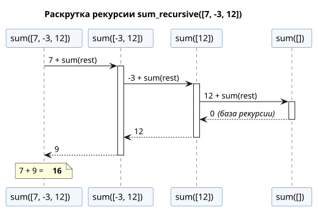
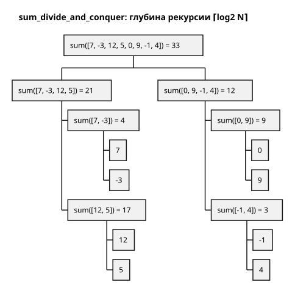
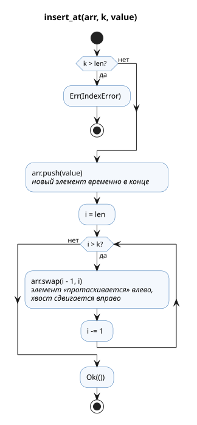
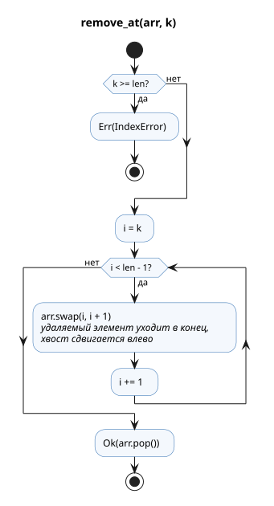

**Имя студента:** Цароев Альберт Казебкович\
**Группа:** ПИЖ-б-о-23-1(1)\
**Предмет:** Контейнерные технологии и DevOps для ИТ-специалистов\
**Претендую на оценку:** Отлично

# Лабораторная работа №2. Рекурсия, вставка и удаление элементов массива

## Цель работы

Изучить рекурсивные функции и операции модификации массива (вставка и удаление
по индексу) со сдвигом элементов, а также обработку некорректных индексов.
Работа выполнена на Rust вместо Go.

## Задание

1. Написать рекурсивную функцию для подсчёта суммы элементов массива.
2. Дан одномерный массив из N элементов. Написать функцию для вставки элемента
   по индексу k.
3. Дан одномерный массив из N элементов. Написать функцию для удаления элемента
   по индексу k.

## Ход работы

### Структура крейта

```text
lb2/
├── Cargo.toml
├── docs/                 — диаграммы PlantUML (*.puml) и их SVG
└── src/
    ├── lib.rs            — функции заданий и тесты
    └── main.rs           — демонстрационная программа
```

### Задание 1. Рекурсивная сумма

Рекурсия естественно записывается через сопоставление со срезом-образцом:
пустой срез — база рекурсии, иначе «первый элемент + сумма остатка».

```rust
pub fn sum_recursive(arr: &[i64]) -> i64 {
    match arr {
        [] => 0,
        [first, rest @ ..] => first + sum_recursive(rest),
    }
}
```

Срез `rest` — это «окно» в тот же массив без копирования, поэтому каждый
рекурсивный вызов стоит O(1) по памяти кучи. Раскрутка рекурсии для
`[7, -3, 12]`:



Недостаток такого решения — глубина рекурсии равна N: каждый вызов занимает
кадр стека, и на массиве из сотен тысяч элементов стек потока (8 МиБ у главного
потока) переполнится. Поэтому дополнительно реализован вариант «разделяй и
властвуй»: массив делится пополам, и глубина рекурсии становится ⌈log₂ N⌉ —
для миллиона элементов всего 20 уровней.

```rust
pub fn sum_divide_and_conquer(arr: &[i64]) -> i64 {
    match arr {
        [] => 0,
        [x] => *x,
        _ => {
            let (left, right) = arr.split_at(arr.len() / 2);
            sum_divide_and_conquer(left) + sum_divide_and_conquer(right)
        }
    }
}
```



### Задания 2 и 3. Вставка и удаление по индексу

Стандартные `Vec::insert` и `Vec::remove` уже делают то, что нужно, поэтому
для учебных целей сдвиг элементов реализован вручную, а стандартные методы
используются в тестах как эталон.

Некорректный индекс — ожидаемая ситуация (например, индекс введён
пользователем), поэтому функции возвращают `Result` с ошибкой `IndexError`, а не
паникуют, как индексирование за границами. При ошибке массив не изменяется.

```rust
pub fn insert_at<T>(arr: &mut Vec<T>, k: usize, value: T) -> Result<(), IndexError> {
    let len = arr.len();
    if k > len {
        return Err(IndexError { index: k, len });
    }
    // Кладём новый элемент в конец и «протаскиваем» его влево до позиции k,
    // попутно сдвигая элементы [k..len) на одну позицию вправо.
    arr.push(value);
    for i in (k..len).rev() {
        arr.swap(i, i + 1);
    }
    Ok(())
}

pub fn remove_at<T>(arr: &mut Vec<T>, k: usize) -> Result<T, IndexError> {
    let len = arr.len();
    if k >= len {
        return Err(IndexError { index: k, len });
    }
    // Перемещаем удаляемый элемент в конец, сдвигая [k+1..len) влево.
    for i in k..len - 1 {
        arr.swap(i, i + 1);
    }
    Ok(arr.pop().expect("массив не пуст: k < len"))
}
```

| insert_at | remove_at |
|:---------:|:---------:|
|  |  |

Решения о реализации:

* Функции обобщённые (`T` — любой тип), а сдвиг выполняется через `swap`,
  поэтому они работают и с типами без `Copy`/`Clone`, например со `String`.
  Удаляемый элемент возвращается вызывающему коду (владение передаётся), а не
  уничтожается.
* Для вставки допустим индекс `k == len` (вставка в конец), для удаления —
  только `k < len`. Это та же семантика, что у `Vec::insert`/`Vec::remove`.
* Сложность обеих операций — O(N − k): сдвигаются только элементы правее `k`.
  Для сравнения, в Go вставка обычно пишется как
  `append(a[:k], append([]int{v}, a[k:]...)...)` и создаёт временный срез.

### Тестирование

Модульные тесты покрывают вставку в начало, середину, конец и в пустой массив,
удаление с краёв и из середины, а также выход за границы. Property-based тесты
(`proptest`) на случайных массивах и индексах проверяют, что:

* обе рекурсивные суммы совпадают с `iter().sum()`;
* `insert_at` и `remove_at` дают тот же результат, что `Vec::insert` и
  `Vec::remove`, а при ошибке не меняют массив;
* вставка с последующим удалением по тому же индексу возвращает исходный
  массив.

## Результаты

```bash
$ cargo run -p lb2
=== Задание 1. Рекурсивная сумма элементов массива ===
Массив: [7, -3, 12, 5, 0, 9, -1, 4]
sum_recursive          = 33
sum_divide_and_conquer = 33
Сумма 1..=1_000_000 (разделяй и властвуй, глубина ~20) = 500000500000

=== Задание 2. Вставка элемента по индексу k ===
Исходный массив: [10, 20, 30, 40, 50]
insert_at(k=2, value=25) -> [10, 20, 25, 30, 40, 50]
insert_at(k=0, value=5) -> [5, 10, 20, 25, 30, 40, 50]
insert_at(k=7, value=60) -> [5, 10, 20, 25, 30, 40, 50, 60]
insert_at(k=10, value=99) -> ошибка: индекс 10 вне диапазона для массива длины 8

=== Задание 3. Удаление элемента по индексу k ===
Исходный массив: [5, 10, 20, 25, 30, 40, 50, 60]
remove_at(k=0) -> удалён 5, массив [10, 20, 25, 30, 40, 50, 60]
remove_at(k=3) -> удалён 30, массив [10, 20, 25, 40, 50, 60]
remove_at(k=5) -> удалён 60, массив [10, 20, 25, 40, 50]
remove_at(k=42) -> ошибка: индекс 42 вне диапазона для массива длины 5
```

```bash
$ cargo test -p lb2
     Running unittests src/lib.rs (target/debug/deps/lb2-…)

running 10 tests
test tests::insert_into_empty ... ok
test tests::insert_into_start_middle_end ... ok
test tests::insert_out_of_range ... ok
test tests::remove_from_start_middle_end ... ok
test tests::sum_small_arrays ... ok
test tests::remove_out_of_range ... ok
test tests::prop_insert_matches_std ... ok
test tests::prop_remove_matches_std ... ok
test tests::prop_insert_then_remove_is_identity ... ok
test tests::prop_sums_match_iterator ... ok

test result: ok. 10 passed; 0 failed; 0 ignored; 0 measured; 0 filtered out; finished in 0.05s

   Doc-tests lb2

running 4 tests
test lb2/src/lib.rs - insert_at (line 78) ... ok
test lb2/src/lib.rs - sum_recursive (line 20) ... ok
test lb2/src/lib.rs - remove_at (line 103) ... ok
test lb2/src/lib.rs - sum_divide_and_conquer (line 33) ... ok

test result: ok. 4 passed; 0 failed; 0 ignored; 0 measured; 0 filtered out; finished in 0.03s
```

## Вывод

Реализованы рекурсивная сумма (в двух вариантах), вставка и удаление элемента
по индексу. Корректность подтверждена 10 модульными и property-based тестами и
4 doc-тестами.

Основные наблюдения:

* сопоставление со срезами-образцами (`[first, rest @ ..]`) делает рекурсивное
  определение в коде дословным повторением математического;
* «наивная» рекурсия имеет глубину O(N) и ограничена размером стека, а
  разбиение пополам снижает глубину до O(log N) при той же асимптотике O(N) по
  времени;
* обработка неверного индекса через `Result` переносит проверку на этап
  компиляции: вызывающий код не может «забыть» про ошибку, а массив при ошибке
  остаётся неизменным;
* обобщённые функции на `swap` работают с любыми типами без лишних
  копирований, а передача удалённого элемента вызывающему наглядно показывает
  модель владения Rust.
