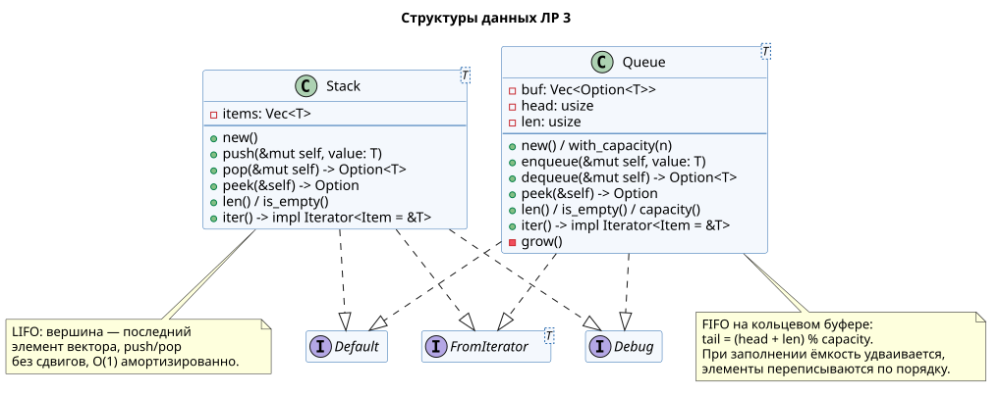
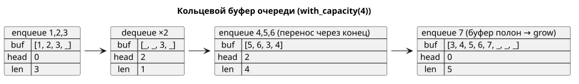

**Имя студента:** Цароев Альберт Казебкович\
**Группа:** ПИЖ-б-о-23-1(1)\
**Предмет:** Контейнерные технологии и DevOps для ИТ-специалистов\
**Претендую на оценку:** Отлично

# Лабораторная работа №3. Структуры данных «очередь» и «стек»

## Цель работы

Реализовать классические абстрактные структуры данных — очередь (FIFO) и стек
(LIFO) — в виде обобщённых типов, изучить их внутреннее устройство и проверить
корректность модельным тестированием. Работа выполнена на Rust вместо Go.

## Задание

1. Реализовать структуру данных очередь с методами для добавления элемента в
   очередь, взятия элемента из очереди и просмотра следующего элемента в
   очереди.
2. Реализовать структуру данных стек с методами для добавления элемента в стек,
   взятия элемента из стека и просмотра следующего элемента в стеке.

## Ход работы

### Структура крейта

```text
lb3/
├── Cargo.toml
├── docs/               — диаграммы классов и кольцевого буфера
└── src/
    ├── lib.rs          — реэкспорт Queue и Stack
    ├── queue.rs        — очередь на кольцевом буфере + тесты
    ├── stack.rs        — стек на динамическом массиве + тесты
    └── main.rs         — демонстрация и пример применения стека
```

### Интерфейс структур



Обе структуры обобщённые (`Queue<T>`, `Stack<T>`) и хранят значения любого
типа. Методы «взять» и «посмотреть» возвращают `Option`: пустая структура — это
штатная ситуация, а не ошибка, и компилятор не даст обратиться к значению без
проверки на `None`. `peek` возвращает ссылку `Option<&T>`: элемент остаётся
во владении структуры и не копируется.

| Операция         | Очередь                     | Стек                     | Сложность |
|------------------|-----------------------------|--------------------------|-----------|
| добавить         | `enqueue(value)`            | `push(value)`            | O(1)*     |
| взять            | `dequeue() -> Option<T>`    | `pop() -> Option<T>`     | O(1)      |
| посмотреть       | `peek() -> Option<&T>`      | `peek() -> Option<&T>`   | O(1)      |
| размер / пустота | `len()`, `is_empty()`       | `len()`, `is_empty()`    | O(1)      |

\* амортизированно: изредка требуется перераспределение памяти.

Дополнительно реализованы `Default`, `FromIterator` (можно писать
`let q: Queue<_> = (1..=5).collect();`), `Debug` и итератор `iter()`.

### Задание 1. Очередь на кольцевом буфере

Простая очередь на `Vec` с удалением из начала (`remove(0)`) стоила бы O(N) на
каждое извлечение, потому что пришлось бы сдвигать все элементы. Поэтому
очередь построена на кольцевом буфере: `head` — индекс первого элемента, `len` —
число элементов, следующий свободный слот вычисляется по модулю ёмкости.

```rust
pub struct Queue<T> {
    buf: Vec<Option<T>>,
    head: usize,
    len: usize,
}

pub fn enqueue(&mut self, value: T) {
    if self.len == self.buf.len() {
        self.grow();
    }
    let tail = (self.head + self.len) % self.buf.len();
    self.buf[tail] = Some(value);
    self.len += 1;
}

pub fn dequeue(&mut self) -> Option<T> {
    if self.len == 0 {
        return None;
    }
    let value = self.buf[self.head].take();
    self.head = (self.head + 1) % self.buf.len();
    self.len -= 1;
    value
}

pub fn peek(&self) -> Option<&T> {
    if self.len == 0 {
        None
    } else {
        self.buf[self.head].as_ref()
    }
}

fn grow(&mut self) {
    let new_cap = (self.buf.len() * 2).max(MIN_CAPACITY);
    let mut new_buf: Vec<Option<T>> = Vec::with_capacity(new_cap);
    // Переносим элементы в порядке очереди, начиная с head.
    for i in 0..self.len {
        let idx = (self.head + i) % self.buf.len();
        new_buf.push(self.buf[idx].take());
    }
    new_buf.resize_with(new_cap, || None);
    self.buf = new_buf;
    self.head = 0;
}
```

Слоты буфера имеют тип `Option<T>`: свободная ячейка — `None`, а
`Option::take()` забирает значение из ячейки, оставляя `None`. Благодаря этому
реализация обходится без `unsafe` и неинициализированной памяти (в воркспейсе
`unsafe_code` запрещён линтом `forbid`). Когда буфер заполнен, ёмкость
удваивается, а элементы переписываются в новом буфере начиная с нуля. Именно
удвоение даёт амортизированную O(1) стоимость вставки.

Состояния буфера на примере из теста `wraps_around_and_grows`:



### Задание 2. Стек на динамическом массиве

У стека и вставка, и извлечение происходят с одного конца, поэтому вершиной
служит конец вектора, и сдвигать элементы не требуется:

```rust
pub struct Stack<T> {
    items: Vec<T>,
}

impl<T> Stack<T> {
    pub fn push(&mut self, value: T) {
        self.items.push(value);
    }

    pub fn pop(&mut self) -> Option<T> {
        self.items.pop()
    }

    pub fn peek(&self) -> Option<&T> {
        self.items.last()
    }
}
```

`Debug` выводит стек от вершины к дну (`top [30, 20, 10] bottom`), а очередь —
от начала к концу (`front [...] back`), чтобы порядок извлечения был нагляден.

В демонстрационной программе стек применяется для классической задачи —
проверки сбалансированности скобок: открывающие скобки кладутся в стек, каждая
закрывающая должна совпасть с вершиной.

### Тестирование

Кроме обычных модульных тестов (пустая структура, порядок FIFO/LIFO, перенос
через конец буфера, рост ёмкости, работа с `String`) применено **модельное
тестирование** с `proptest`. Генерируется случайная последовательность из
сотен операций (`Enqueue(x)` / `Dequeue` / `Peek`), выполняется одновременно
над нашей структурой и над эталоном из стандартной библиотеки (`VecDeque` для
очереди, `Vec` для стека), и после каждого шага сравниваются результаты и
длина. Такой тест находит ошибки на границах кольцевого буфера, которые трудно
предусмотреть вручную.

## Результаты

```bash
$ cargo run -p lb3
=== Задание 1. Очередь (FIFO) ===
enqueue(Анна ) -> front ["Анна"] back
enqueue(Борис) -> front ["Анна", "Борис"] back
enqueue(Вера ) -> front ["Анна", "Борис", "Вера"] back
peek()          -> Some("Анна")
dequeue()       -> Some("Анна"), очередь front ["Борис", "Вера"] back
enqueue(Глеб ) -> front ["Борис", "Вера", "Глеб"] back (ёмкость буфера 4)
enqueue(Дина ) -> front ["Борис", "Вера", "Глеб", "Дина"] back (ёмкость буфера 4)
enqueue(Егор ) -> front ["Борис", "Вера", "Глеб", "Дина", "Егор"] back (ёмкость буфера 8)
dequeue()       -> Борис осталось 4
dequeue()       -> Вера  осталось 3
dequeue()       -> Глеб  осталось 2
dequeue()       -> Дина  осталось 1
dequeue()       -> Егор  осталось 0
peek() пустой   -> None

=== Задание 2. Стек (LIFO) ===
push(10)  -> top [10] bottom
push(20)  -> top [20, 10] bottom
push(30)  -> top [30, 20, 10] bottom
peek()    -> Some(30)
pop()     -> Some(30), стек top [20, 10] bottom
pop()     -> Some(20), стек top [10] bottom
pop()     -> Some(10), стек top [] bottom
pop()     -> None (стек пуст)

Применение стека: проверка скобок
  {[()()]}                             -> сбалансированы
  fn main() { let v = vec![1, 2]; }    -> сбалансированы
  ([)]                                 -> НЕ сбалансированы
  (()                                  -> НЕ сбалансированы
```

```bash
$ cargo test -p lb3
     Running unittests src/lib.rs (target/debug/deps/lb3-…)

running 9 tests
test queue::tests::empty_queue ... ok
test queue::tests::fifo_order ... ok
test queue::tests::works_with_non_copy_types ... ok
test stack::tests::empty_stack ... ok
test stack::tests::debug_shows_top_first ... ok
test queue::tests::wraps_around_and_grows ... ok
test stack::tests::lifo_order ... ok
test stack::tests::prop_behaves_like_vec ... ok
test queue::tests::prop_behaves_like_vecdeque ... ok

test result: ok. 9 passed; 0 failed; 0 ignored; 0 measured; 0 filtered out; finished in 0.31s

   Doc-tests lb3

running 2 tests
test lb3/src/queue.rs - queue::Queue (line 13) ... ok
test lb3/src/stack.rs - stack::Stack (line 10) ... ok

test result: ok. 2 passed; 0 failed; 0 ignored; 0 measured; 0 filtered out; finished in 0.00s
```

В выводе программы видно, что пятый элемент `Егор` не поместился в буфер
ёмкостью 4 и вызвал его удвоение до 8, при этом порядок FIFO сохранился.

## Вывод

Реализованы обобщённые очередь и стек со всеми требуемыми операциями
(добавить, взять, посмотреть) и вспомогательными методами. Очередь построена на
кольцевом буфере с удвоением ёмкости, поэтому все операции выполняются за
амортизированное O(1), тогда как наивная очередь на массиве тратила бы O(N) на
каждое извлечение.

Использование `Option` для пустой структуры и для свободных ячеек буфера
позволило обойтись без `unsafe` и исключить обращение к пустой структуре на
уровне типов. Модельное тестирование против `VecDeque` и `Vec` из стандартной
библиотеки на тысячах случайных сценариев подтвердило, что поведение
реализаций совпадает с эталонным, включая переходы через границу кольцевого
буфера.
