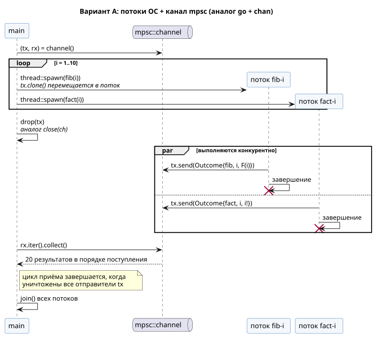
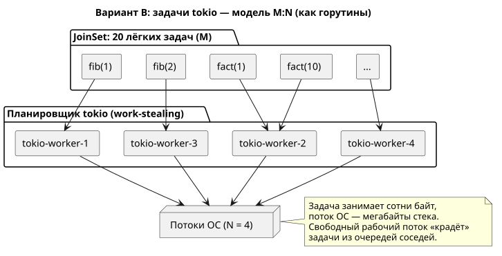

**Имя студента:** Цароев Альберт Казебкович\
**Группа:** ПИЖ-б-о-23-1(1)\
**Предмет:** Контейнерные технологии и DevOps для ИТ-специалистов\
**Претендую на оценку:** Отлично

# Лабораторная работа №4. Конкурентные вычисления (аналог горутин)

## Цель работы

Изучить средства конкурентного выполнения кода: запуск независимых
вычислений, передачу результатов между ними через канал и ожидание
завершения. В оригинальном задании используются горутины Go; в работе
показаны два эквивалента в Rust — потоки ОС и асинхронные задачи `tokio`.

## Задание

1. Написать две функции: одна должна считать i-е число Фибоначчи, а вторая
   факториал. Запустить их как горутины в цикле от 1 до 10.
2. Считать с консоли 10 чисел, записать их в массив или срез. Введённые числа
   передавать в функции для подсчёта i-го числа Фибоначчи и факториала. Данные
   функции должны запускаться как горутины.

## Ход работы

### Структура крейта

```text
lb4/
├── Cargo.toml          — зависимость tokio (рантайм для варианта B)
├── docs/               — диаграммы взаимодействия
└── src/
    ├── lib.rs          — вычисления, запуск потоков/задач, чтение ввода, тесты
    └── main.rs         — подкоманды task1 и task2
```

### Чем заменить горутину

| Go                         | Rust, вариант A               | Rust, вариант B                   |
|----------------------------|-------------------------------|-----------------------------------|
| `go f(i)`                  | `thread::spawn(move \|\| f(i))`| `JoinSet::spawn(async move {..})` |
| `ch := make(chan T)`       | `mpsc::channel()`             | результат задачи в `JoinSet`      |
| `close(ch)`                | `drop(tx)`                    | —                                 |
| `sync.WaitGroup.Wait()`    | `JoinHandle::join()`          | `join_next().await`               |
| планировщик M:N рантайма Go | 1 поток ОС на задачу (1:1)   | M задач на N рабочих потоков (M:N) |

Горутина — лёгкая задача, которую рантайм Go распределяет по небольшому числу
потоков ОС. Ближайший аналог в Rust — асинхронная задача `tokio`. Потоки ОС
(`std::thread`) тяжелее (собственный стек в мегабайты), но не требуют
асинхронного рантайма; для 20 коротких вычислений подходят оба варианта, поэтому
программа демонстрирует оба.

### Функции вычисления

Результаты быстро растут, поэтому используется самый широкий встроенный
беззнаковый тип `u128`, а переполнение явно обнаруживается через
`checked_add`/`checked_mul` и возвращается как ошибка `Overflow` (Go молча
«завернул» бы значение). Граница: `F(186)` и `34!` — наибольшие значения,
помещающиеся в `u128`.

```rust
pub fn fibonacci(n: u32) -> Result<u128, Overflow> {
    if n == 0 {
        return Ok(0);
    }
    // Инвариант: a = F(k-1), b = F(k). Не вычисляем F(n+1), чтобы
    // F(186) — последнее помещающееся в u128 число — не давало переполнения.
    let (mut a, mut b) = (0_u128, 1_u128);
    for _ in 1..n {
        let next = a.checked_add(b).ok_or(Overflow)?;
        a = b;
        b = next;
    }
    Ok(b)
}

pub fn factorial(n: u32) -> Result<u128, Overflow> {
    (1..=u128::from(n)).try_fold(1_u128, |acc, k| acc.checked_mul(k).ok_or(Overflow))
}
```

Числа Фибоначчи считаются итеративно за O(n): наивная рекурсия
`F(n-1) + F(n-2)` имела бы экспоненциальную сложность.

На этапе отладки тест `overflow_boundaries` выявил ошибку первой версии
`fibonacci`: цикл вычислял лишний член последовательности `F(n+1)` и ложно
сообщал о переполнении для `F(186)`. После исправления инвариант цикла
сформулирован так, чтобы не выходить за n.

### Вариант A: потоки ОС и канал



```rust
pub fn run_threads(inputs: &[u32]) -> Vec<Outcome> {
    let (tx, rx) = mpsc::channel();
    let mut handles = Vec::with_capacity(inputs.len() * 2);

    for (index, &n) in inputs.iter().enumerate() {
        for kind in [Kind::Fibonacci, Kind::Factorial] {
            let tx = tx.clone();
            let handle = thread::Builder::new()
                .name(format!("{kind}-{n}"))
                .spawn(move || {
                    let value = kind.compute(n);
                    let (worker, thread_id) = current_worker();
                    let _ = tx.send(Outcome { index, kind, n, value, worker, thread_id });
                })
                .expect("не удалось создать поток");
            handles.push(handle);
        }
    }
    // Закрываем исходный отправитель, чтобы цикл приёма завершился,
    // когда отработают все потоки (аналог close(ch) в Go).
    drop(tx);

    let outcomes: Vec<Outcome> = rx.iter().collect();
    for h in handles {
        h.join().expect("поток завершился паникой");
    }
    outcomes
}
```

Каждый поток получает свою копию отправителя `tx` (`move`-замыкание забирает
её во владение) и именуется по выполняемой функции (`fib-7`, `fact-7`), чтобы в
выводе было видно, кто прислал результат. Цикл `rx.iter()` заканчивается, когда
уничтожены все отправители, поэтому важно удалить исходный `tx` в главном
потоке. В Go это соответствует `close(ch)`; если забыть, программа зависнет —
в Go так же, как и в Rust.

Гонки данных исключены на этапе компиляции: замыкание потока обязано быть
`Send + 'static`, поэтому передать в поток ссылку на локальную переменную или
неразделяемые данные нельзя.

### Вариант B: задачи tokio (модель M:N)



```rust
pub async fn run_tasks(inputs: &[u32]) -> Vec<Outcome> {
    let mut set = tokio::task::JoinSet::new();
    for (index, &n) in inputs.iter().enumerate() {
        for kind in [Kind::Fibonacci, Kind::Factorial] {
            set.spawn(async move {
                let (worker, thread_id) = current_worker();
                Outcome { index, kind, n, value: kind.compute(n), worker, thread_id }
            });
        }
    }
    let mut outcomes = Vec::with_capacity(set.len());
    while let Some(res) = set.join_next().await {
        outcomes.push(res.expect("задача завершилась паникой"));
    }
    outcomes
}
```

Рантайм создаётся с 4 рабочими потоками (`tokio-worker-1..4`), а 20 задач
распределяются между ними планировщиком с перехватом работы (work stealing) —
так же, как рантайм Go распределяет горутины по потокам ОС (`GOMAXPROCS`).
`JoinSet::join_next` возвращает результаты в порядке завершения задач.

### Задание 2. Ввод с консоли

Чтение вынесено в функцию `read_numbers`, которая принимает любой `BufRead`.
Поэтому в тестах вместо консоли подставляется строка. Числа можно вводить через
пробел и/или Enter; некорректные токены (буквы, отрицательные числа) не
прерывают ввод, а пропускаются с предупреждением в stderr. Если ввод
закончился раньше, чем набралось 10 чисел, программа завершается с ошибкой и
кодом возврата 1. Прочитанные числа сохраняются в `Vec<u32>` и передаются тем же
функциям `run_threads` и `run_tasks`.

### Тестирование

Тесты проверяют первые значения обеих последовательностей, точные границы
переполнения (`F(186)`, `F(187)`, `34!`, `35!`), полноту результатов обоих
конкурентных вариантов (каждое из 20 вычислений выполнено ровно один раз, в
варианте A — каждое в отдельном потоке, в варианте B — не более чем на 2
рабочих потоках) и разбор ввода с мусором и преждевременным концом.

## Результаты

### Задание 1

```bash
$ cargo run -p lb4 -- task1
=== Задание 1. Горутины в цикле от 1 до 10 ===
--- Вариант A: потоки ОС (std::thread) + канал mpsc ---
Порядок поступления результатов в канал:
   1. fib (  2) = 1                                        [fib-2]
   2. fib (  1) = 1                                        [fib-1]
   3. fact(  1) = 1                                        [fact-1]
   4. fact(  2) = 2                                        [fact-2]
   5. fact(  4) = 24                                       [fact-4]
   6. fib (  3) = 2                                        [fib-3]
   7. fib (  4) = 3                                        [fib-4]
   8. fact(  3) = 6                                        [fact-3]
   9. fib (  5) = 5                                        [fib-5]
  10. fact(  5) = 120                                      [fact-5]
  11. fib (  6) = 8                                        [fib-6]
  12. fact(  6) = 720                                      [fact-6]
  13. fib (  7) = 13                                       [fib-7]
  14. fact(  7) = 5040                                     [fact-7]
  15. fib (  8) = 21                                       [fib-8]
  16. fact(  8) = 40320                                    [fact-8]
  17. fib (  9) = 34                                       [fib-9]
  18. fib ( 10) = 55                                       [fib-10]
  19. fact(  9) = 362880                                   [fact-9]
  20. fact( 10) = 3628800                                  [fact-10]

Итоговая таблица (отсортирована по входу):
     n |                                   fib(n) |                                       n!
  ------------------------------------------------------------------------------------------
     1 |                                        1 |                                        1
     2 |                                        1 |                                        2
     3 |                                        2 |                                        6
     4 |                                        3 |                                       24
     5 |                                        5 |                                      120
     6 |                                        8 |                                      720
     7 |                                       13 |                                     5040
     8 |                                       21 |                                    40320
     9 |                                       34 |                                   362880
    10 |                                       55 |                                  3628800

--- Вариант B: асинхронные задачи tokio (M:N, аналог горутин) ---
Порядок завершения задач (JoinSet::join_next):
   1. fib (  1) = 1                                        [tokio-worker-2]
   2. fact(  1) = 1                                        [tokio-worker-2]
   3. fib (  2) = 1                                        [tokio-worker-2]
   4. fib (  3) = 2                                        [tokio-worker-2]
   5. fact(  3) = 6                                        [tokio-worker-2]
   6. fact(  4) = 24                                       [tokio-worker-2]
   7. fact(  2) = 2                                        [tokio-worker-1]
   8. fib (  4) = 3                                        [tokio-worker-4]
   9. fib (  5) = 5                                        [tokio-worker-2]
  10. fib (  6) = 8                                        [tokio-worker-2]
  11. fact(  6) = 720                                      [tokio-worker-2]
  12. fact(  5) = 120                                      [tokio-worker-4]
  13. fact(  7) = 5040                                     [tokio-worker-2]
  14. fib (  7) = 13                                       [tokio-worker-1]
  15. fib (  8) = 21                                       [tokio-worker-4]
  16. fact(  8) = 40320                                    [tokio-worker-2]
  17. fib (  9) = 34                                       [tokio-worker-1]
  18. fact(  9) = 362880                                   [tokio-worker-2]
  19. fib ( 10) = 55                                       [tokio-worker-2]
  20. fact( 10) = 3628800                                  [tokio-worker-1]

Задач: 20; рабочих потоков рантайма, выполнивших их: 3 {"tokio-worker-1", "tokio-worker-2", "tokio-worker-4"}
```

Порядок поступления результатов при каждом запуске разный: потоки и задачи
выполняются конкурентно, и порядок определяется планировщиком. Итоговая
таблица одинакова всегда, так как результаты сортируются по входному индексу.

### Задание 2

Для воспроизводимости ввод передан через конвейер; в интерактивном режиме
числа вводятся с клавиатуры. Во входных данных намеренно есть некорректные
токены `x` и `-1`, а также значения на границе переполнения.

```bash
$ printf '3 15 x 0\n42 -1 100 7 1 25 186 187\n' | cargo run -p lb4 -- task2
=== Задание 2. Обработка 10 чисел, введённых с консоли ===
Введите 10 неотрицательных целых чисел через пробел или Enter: 
  пропущено «x»: ожидалось целое число ≥ 0
  пропущено «-1»: ожидалось целое число ≥ 0

Считанный срез: [3, 15, 0, 42, 100, 7, 1, 25, 186, 187]

--- Вариант A: потоки ОС (std::thread) + канал mpsc ---
Порядок поступления результатов в канал:
   1. fact( 15) = 1307674368000                            [fact-15]
   2. fib (  3) = 2                                        [fib-3]
   3. fib ( 15) = 610                                      [fib-15]
   4. fact(  3) = 6                                        [fact-3]
   5. fib (  0) = 0                                        [fib-0]
   6. fib ( 42) = 267914296                                [fib-42]
   7. fact(  0) = 1                                        [fact-0]
   8. fact(100) = ошибка: переполнение u128                [fact-100]
   9. fib (  7) = 13                                       [fib-7]
  10. fact(  7) = 5040                                     [fact-7]
  11. fib (100) = 354224848179261915075                    [fib-100]
  12. fib (  1) = 1                                        [fib-1]
  13. fact( 42) = ошибка: переполнение u128                [fact-42]
  14. fact(  1) = 1                                        [fact-1]
  15. fib ( 25) = 75025                                    [fib-25]
  16. fact( 25) = 15511210043330985984000000               [fact-25]
  17. fib (186) = 332825110087067562321196029789634457848  [fib-186]
  18. fact(186) = ошибка: переполнение u128                [fact-186]
  19. fib (187) = ошибка: переполнение u128                [fib-187]
  20. fact(187) = ошибка: переполнение u128                [fact-187]

Итоговая таблица (отсортирована по входу):
     n |                                   fib(n) |                                       n!
  ------------------------------------------------------------------------------------------
     3 |                                        2 |                                        6
    15 |                                      610 |                            1307674368000
     0 |                                        0 |                                        1
    42 |                                267914296 |                        переполнение u128
   100 |                    354224848179261915075 |                        переполнение u128
     7 |                                       13 |                                     5040
     1 |                                        1 |                                        1
    25 |                                    75025 |               15511210043330985984000000
   186 |  332825110087067562321196029789634457848 |                        переполнение u128
   187 |                        переполнение u128 |                        переполнение u128

--- Вариант B: асинхронные задачи tokio (M:N, аналог горутин) ---
Порядок завершения задач (JoinSet::join_next):
   1. fib (  3) = 2                                        [tokio-worker-2]
   2. fact(  3) = 6                                        [tokio-worker-3]
   3. fib ( 15) = 610                                      [tokio-worker-4]
   4. fib (  0) = 0                                        [tokio-worker-1]
   5. fact(  0) = 1                                        [tokio-worker-2]
   6. fact(100) = ошибка: переполнение u128                [tokio-worker-1]
   7. fact( 42) = ошибка: переполнение u128                [tokio-worker-3]
   8. fact( 15) = 1307674368000                            [tokio-worker-4]
   9. fib (  7) = 13                                       [tokio-worker-1]
  10. fib ( 42) = 267914296                                [tokio-worker-2]
  11. fact(  7) = 5040                                     [tokio-worker-1]
  12. fib (  1) = 1                                        [tokio-worker-1]
  13. fact(  1) = 1                                        [tokio-worker-4]
  14. fib (100) = 354224848179261915075                    [tokio-worker-3]
  15. fact( 25) = 15511210043330985984000000               [tokio-worker-2]
  16. fib (186) = 332825110087067562321196029789634457848  [tokio-worker-1]
  17. fib ( 25) = 75025                                    [tokio-worker-4]
  18. fact(186) = ошибка: переполнение u128                [tokio-worker-3]
  19. fact(187) = ошибка: переполнение u128                [tokio-worker-1]
  20. fib (187) = ошибка: переполнение u128                [tokio-worker-2]

Задач: 20; рабочих потоков рантайма, выполнивших их: 4 {"tokio-worker-1", "tokio-worker-2", "tokio-worker-3", "tokio-worker-4"}
```

### Тесты

```bash
$ cargo test -p lb4
     Running unittests src/lib.rs (target/debug/deps/lb4-…)

running 7 tests
test tests::fibonacci_first_values ... ok
test tests::overflow_boundaries ... ok
test tests::factorial_first_values ... ok
test tests::read_numbers_reports_eof ... ok
test tests::read_numbers_skips_garbage ... ok
test tests::tasks_compute_everything ... ok
test tests::threads_compute_everything ... ok

test result: ok. 7 passed; 0 failed; 0 ignored; 0 measured; 0 filtered out; finished in 0.00s

   Doc-tests lb4

running 2 tests
test lb4/src/lib.rs - fibonacci (line 34) ... ok
test lb4/src/lib.rs - factorial (line 54) ... ok

test result: ok. 2 passed; 0 failed; 0 ignored; 0 measured; 0 filtered out; finished in 0.00s
```

## Вывод

Обе функции запущены конкурентно двумя способами, эквивалентными горутинам
Go: потоками ОС с каналом `mpsc` (модель CSP — «общайтесь, передавая
сообщения») и лёгкими задачами `tokio` (модель M:N, как у планировщика Go).
Вывод программы подтверждает конкурентность: порядок поступления результатов
отличается от порядка запуска и меняется от запуска к запуску, а в варианте B
20 задач выполнены на 3–4 рабочих потоках.

По сравнению с Go модель владения Rust переносит часть ошибок конкурентности на
этап компиляции: данные в поток передаются только через `move` и должны быть
`Send`, поэтому гонка данных невозможна без явной синхронизации. Переполнение
`u128` обнаруживается явно, так что для `F(187)`, `35!` и больших значений
программа сообщает об ошибке, а не печатает неверное число.
