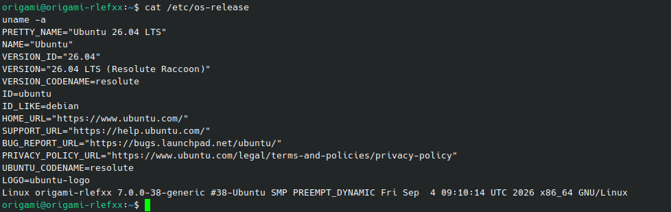
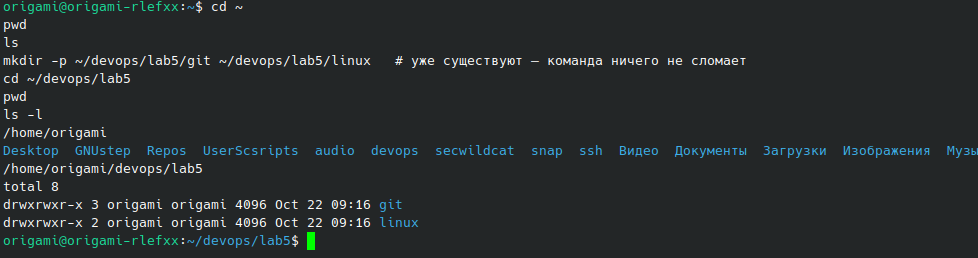
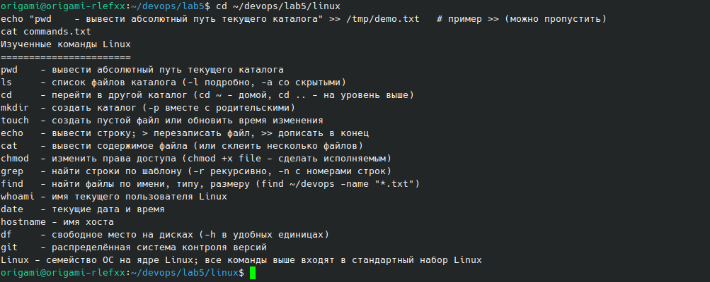
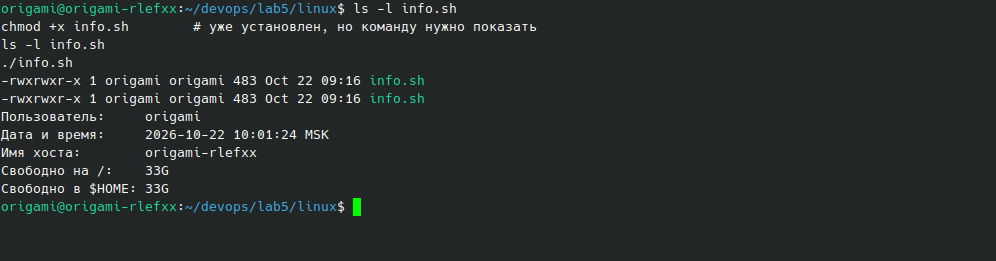
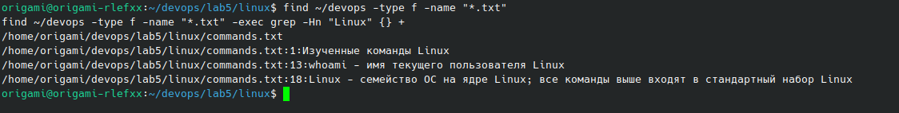
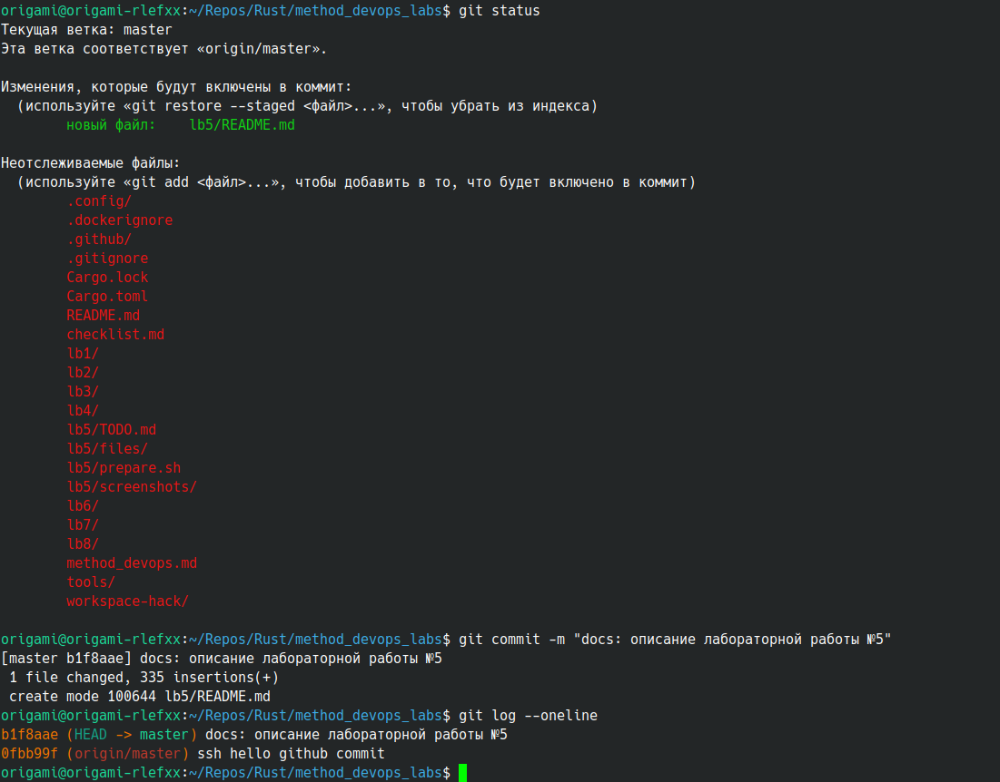
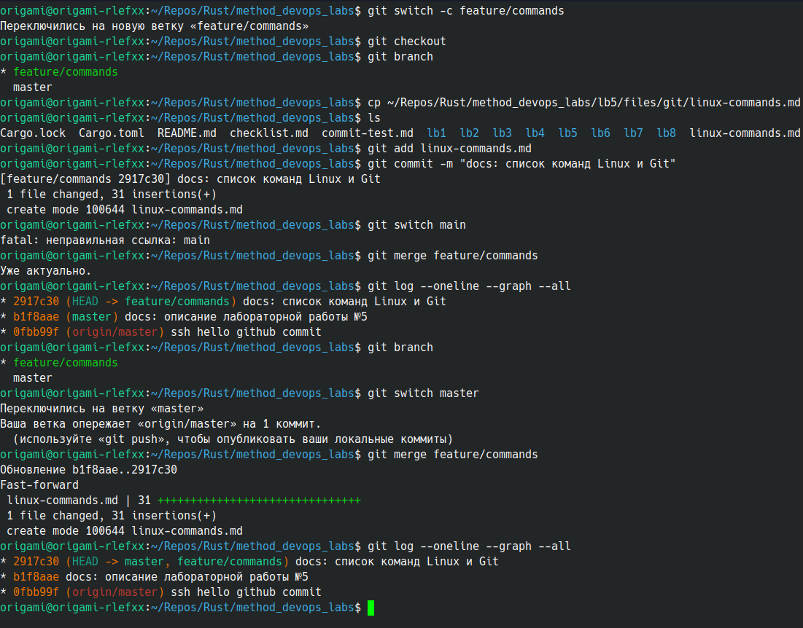
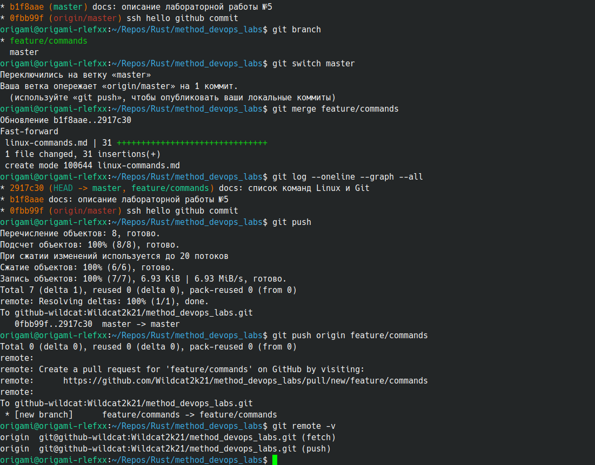

**Имя студента:** Цароев Альберт Казебкович\
**Группа:** ПИЖ-б-о-23-1(1)\
**Предмет:** Контейнерные технологии и DevOps для ИТ-специалистов\
**Претендую на оценку:** Отлично

# Лабораторная работа №5. Основы Linux и Git

## Цель работы

Освоить базовые команды Linux для работы с файловой системой, файлами,
правами доступа и поиском, научиться писать простые shell-скрипты, а также
изучить основной цикл работы с Git: настройку, коммиты, ветки, слияние,
игнорирование файлов, разрешение конфликтов и публикацию на GitHub.

**Ссылка на удалённый репозиторий:** <https://github.com/Wildcat2k21/method_devops_labs>

## Задание

1. Установить Linux в виртуальной машине или использовать WSL 2.
2. Выполнить команды навигации `pwd`, `ls`, `cd`; создать каталоги
   `~/devops/lab5/git` и `~/devops/lab5/linux`.
3. Создать в каталоге `linux` файл `commands.txt` со списком изученных команд,
   используя `echo`, `cat` и перенаправление вывода.
4. Создать скрипт `info.sh`, выводящий имя пользователя, дату и время, имя
   хоста и свободное место на диске; сделать его исполняемым и запустить.
5. С помощью `grep` и `find` найти все `.txt` в `~/devops` и вывести строки со
   словом Linux.
6. Настроить Git: имя пользователя и email.
7. Создать репозиторий в `~/devops/lab5/git`, добавить `README.md`, выполнить
   первый коммит.
8. Создать ветку `feature/commands`, добавить `linux-commands.md`, закоммитить,
   слить с `main`.
9. Создать на GitHub репозиторий `devops-lab5` и отправить в него локальный
   репозиторий.
10. Создать `.gitignore`, исключающий `*.log`, `*.tmp` и каталог `.venv`;
    проверить, что такие файлы не попадают в индекс.
11. Смоделировать и вручную разрешить конфликт слияния.
12. Оформить отчёт.

## Ход работы

### Организация работы

Задание предполагает отдельный локальный репозиторий `~/devops/lab5/git` и
отдельный удалённый репозиторий `devops-lab5`. Поскольку все лабораторные
работы курса ведутся в одном Cargo-воркспейсе, git-часть работы (шаги 7–11)
выполнена прямо в его репозитории, а материалы ЛР 5 лежат в каталоге `lb5/`.
Отдельный репозиторий `devops-lab5` не создавался: его роль выполняет общий
репозиторий <https://github.com/Wildcat2k21/method_devops_labs>. Основная
ветка — `master` (в тексте задания — `main`). Linux-часть (шаги 2–5)
выполнена, как требуется, в `~/devops/lab5`.

```text
lb5/
├── README.md                — этот отчёт (шаг 7: первый коммит работы)
├── linux-commands.md        — шпаргалка команд (шаг 8, ветка feature/commands; шаг 11)
├── prepare.sh               — подготовка ~/devops/lab5: commands.txt, info.sh (шаги 2–4)
├── files/linux/info.sh      — скрипт шага 4
└── screenshots/             — скриншоты шагов 1–9
```

### Шаг 1. Операционная система

Работа выполняется в Ubuntu 26.04 LTS, установленной на компьютер (нативно,
без виртуальной машины).

```bash
$ cat /etc/os-release | head -4
PRETTY_NAME="Ubuntu 26.04 LTS"
NAME="Ubuntu"
VERSION_ID="26.04"
VERSION="26.04 LTS (Resolute Raccoon)"
$ uname -srm
Linux 7.0.0-38-generic x86_64
```



### Шаг 2. Навигация и структура каталогов

| Команда                                       | Пояснение                                                   |
|-----------------------------------------------|-------------------------------------------------------------|
| `pwd`                                         | вывести абсолютный путь текущего каталога                   |
| `ls`, `ls -l`, `ls -la`                       | список файлов; `-l` — подробно, `-a` — включая скрытые      |
| `cd ~`, `cd ..`, `cd ~/devops/lab5`           | перейти в домашний, родительский или указанный каталог      |
| `mkdir -p ~/devops/lab5/git ~/devops/lab5/linux` | создать каталоги вместе с отсутствующими родительскими   |



### Шаг 3. Файл commands.txt

Файл собирается только средствами оболочки: первая строка записывается с
перезаписью (`>`), следующие дописываются (`>>`), а блок из нескольких строк
добавляется командой `cat` с heredoc:

```bash
cd ~/devops/lab5/linux
echo "Изученные команды Linux" > commands.txt
echo "=======================" >> commands.txt
echo "pwd    - вывести абсолютный путь текущего каталога" >> commands.txt
# ...
cat >> commands.txt <<'EOF'
touch  - создать пустой файл или обновить время изменения
echo   - вывести строку; > перезаписать файл, >> дописать в конец
# ...
EOF
cat commands.txt
```

```text
Изученные команды Linux
=======================
pwd    - вывести абсолютный путь текущего каталога
ls     - список файлов каталога (-l подробно, -a со скрытыми)
cd     - перейти в другой каталог (cd ~ - домой, cd .. - на уровень выше)
mkdir  - создать каталог (-p вместе с родительскими)
touch  - создать пустой файл или обновить время изменения
echo   - вывести строку; > перезаписать файл, >> дописать в конец
cat    - вывести содержимое файла (или склеить несколько файлов)
chmod  - изменить права доступа (chmod +x file - сделать исполняемым)
grep   - найти строки по шаблону (-r рекурсивно, -n с номерами строк)
find   - найти файлы по имени, типу, размеру (find ~/devops -name "*.txt")
whoami - имя текущего пользователя Linux
date   - текущие дата и время
hostname - имя хоста
df     - свободное место на дисках (-h в удобных единицах)
git    - распределённая система контроля версий
Linux - семейство ОС на ядре Linux; все команды выше входят в стандартный набор Linux
```



### Шаг 4. Скрипт info.sh

```bash
#!/usr/bin/env bash
# ЛР 5, шаг 4: сведения о пользователе, времени, хосте и свободном месте.

echo "Пользователь:     $(whoami)"
echo "Дата и время:     $(date '+%Y-%m-%d %H:%M:%S %Z')"
echo "Имя хоста:        $(hostname)"
echo "Свободно на /:    $(df -h --output=avail / | tail -n 1 | tr -d ' ')"
echo "Свободно в \$HOME: $(df -h --output=avail "$HOME" | tail -n 1 | tr -d ' ')"
```

Строка `#!/usr/bin/env bash` (shebang) указывает интерпретатор. `$(…)` —
подстановка вывода команды. `df --output=avail` выводит только столбец
свободного места, а `tail -n 1` отбрасывает заголовок. Чтобы скрипт можно
было запускать как программу (`./info.sh`), ему нужно право на исполнение:
`chmod +x info.sh` (права меняются с `-rw-rw-r--` на `-rwxrwxr-x`).

```bash
$ chmod +x info.sh
$ ./info.sh
Пользователь:     origami
Дата и время:     2026-10-22 09:16:30 MSK
Имя хоста:        origami-rlefxx
Свободно на /:    23G
Свободно в $HOME: 23G
```



### Шаг 5. Поиск файлов и строк

`find` находит файлы по критериям, `-exec … {} +` передаёт найденные файлы
команде `grep`. Ключ `-H` выводит имя файла, `-n` — номер строки:

```bash
$ find ~/devops -type f -name "*.txt" -exec grep -Hn "Linux" {} +
/home/origami/devops/lab5/linux/commands.txt:1:Изученные команды Linux
/home/origami/devops/lab5/linux/commands.txt:13:whoami - имя текущего пользователя Linux
/home/origami/devops/lab5/linux/commands.txt:18:Linux - семейство ОС на ядре Linux; все команды выше входят в стандартный набор Linux
```

Тот же результат даёт один `grep`: `grep -rn --include='*.txt' Linux ~/devops`.



### Шаг 6. Настройка Git

```bash
git config --global user.name  "wildcat2k21"
git config --global user.email "wildcat2k21@gmail.com"
git config --global --list | grep user
```

Ключ `--global` сохраняет настройки в `~/.gitconfig` для всех репозиториев
пользователя. Имя и email записываются в каждый коммит как автор.


### Шаг 7. Первый коммит

Репозиторий воркспейса уже существовал (`git init`, подключённый `origin` и
пробный коммит при настройке SSH-доступа к GitHub). Первым коммитом работы
добавлен файл с её описанием — этот отчёт `lb5/README.md`:

```bash
git status                  # lb5/README.md — в индексе, остальное не отслеживается
git add lb5/README.md       # добавить в индекс (staging area)
git commit -m "docs: описание лабораторной работы №5"
git log --oneline
```

`git add` переносит изменения в индекс, `git commit` фиксирует содержимое
индекса как новый снимок (коммит) с автором, датой и сообщением.



### Шаг 8. Ветка feature/commands и слияние

```bash
git switch -c feature/commands      # создать ветку и перейти в неё
cp …/linux-commands.md .
git add linux-commands.md
git commit -m "docs: список команд Linux и Git"
git switch master
git merge feature/commands          # Fast-forward
git log --oneline --graph --all
```

Так как после создания ветки в `master` не было новых коммитов, слияние
выполнено перемоткой (fast-forward): указатель `master` просто сдвинулся на
коммит ветки, отдельный коммит слияния не понадобился. На скриншоте также
видна попытка `git switch main`: ветки `main` в этом репозитории нет, основная
ветка называется `master`. Позже файл перенесён в `lb5/linux-commands.md`
(`git mv`, история сохранена).



### Шаг 9. Публикация на GitHub

Удалённый репозиторий подключён по SSH через алиас `github-wildcat` из
`~/.ssh/config` (отдельный ключ для этого аккаунта GitHub):

```bash
git push                            # master -> origin/master
git push origin feature/commands    # новая ветка на GitHub
git remote -v
```



Ссылка на репозиторий: <https://github.com/Wildcat2k21/method_devops_labs>.

### Шаг 10. Файл .gitignore

В воркспейсе `.gitignore` уже исключал артефакты сборки Rust. В него
добавлены правила задания: `*.log`, `*.tmp` и каталог `.venv/`. Проверка: созданы
файлы, подпадающие под правила; `git add` отказывается их добавлять, а
`git check-ignore -v` показывает, каким правилом исключён каждый файл:

```bash
$ cat .gitignore
# Сборка Rust
/target/
**/*.rs.bk
*.profraw
lcov.info
coverage/

# PDF-версии отчётов (генерируются tools/build_pdf.py)
lb*/README.pdf

# ЛР 5, шаг 10: журналы, временные файлы и виртуальное окружение Python
*.log
*.tmp
.venv/
__pycache__/

$ touch debug.log lb5/cache.tmp && mkdir -p .venv && touch .venv/pyvenv.cfg

$ ls -a debug.log lb5/cache.tmp .venv
debug.log
lb5/cache.tmp

.venv:
.
..
pyvenv.cfg

$ git status --short -- .gitignore debug.log lb5/cache.tmp .venv
?? .gitignore

$ git add debug.log
Следующие пути игнорируются одним из ваших файлов .gitignore:
debug.log
hint: Use -f if you really want to add them.
hint: Disable this message with "git config set advice.addIgnoredFile false"

$ git check-ignore -v debug.log lb5/cache.tmp .venv/pyvenv.cfg target/
.gitignore:12:*.log	debug.log
.gitignore:13:*.tmp	lb5/cache.tmp
.gitignore:14:.venv/	.venv/pyvenv.cfg
.gitignore:2:/target/	target/

$ git add .gitignore

$ git status --short --ignored -- .gitignore debug.log lb5/cache.tmp .venv
A  .gitignore
!! .venv/
!! debug.log
!! lb5/cache.tmp

$ git commit -m "chore: .gitignore для target/, *.log, *.tmp и .venv"
[master 7600fc1] chore: .gitignore для target/, *.log, *.tmp и .venv
 1 file changed, 15 insertions(+)
 create mode 100644 .gitignore

$ rm -rf debug.log lb5/cache.tmp .venv
```

`git status --ignored` помечает исключённые файлы как `!!`. В индекс попал
только сам `.gitignore` (`A`). Без `/target/` в `.gitignore` git видел бы более
10 тысяч файлов артефактов сборки — именно это произошло при первой попытке
шага, когда шаблонный `.gitignore` заменил файл воркспейса.

### Шаг 11. Конфликт слияния

Две ветки изменяют одну и ту же (первую) строку `lb5/linux-commands.md`
по-разному. Первая ветка сливается перемоткой, вторая — с конфликтом:

```bash
$ head -n 1 lb5/linux-commands.md
# Основные команды Linux

$ git switch -c conflict-a
Переключились на новую ветку «conflict-a»

$ sed -i '1s/.*/# Основные команды Linux и Git/' lb5/linux-commands.md

$ git commit -q -am 'docs(lb5): заголовок шпаргалки (ветка conflict-a)' --trailer 'Co-Authored-By: Claude Opus 5.5 <noreply@anthropic.com>'

$ git switch master
Переключились на ветку «master»
Ваша ветка опережает «origin/master» на 11 коммитов.
  (используйте «git push», чтобы опубликовать ваши локальные коммиты)

$ git switch -c conflict-b
Переключились на новую ветку «conflict-b»

$ sed -i '1s/.*/# Шпаргалка: команды Linux/' lb5/linux-commands.md

$ git commit -q -am 'docs(lb5): заголовок шпаргалки (ветка conflict-b)' --trailer 'Co-Authored-By: Claude Opus 5.5 <noreply@anthropic.com>'

$ git switch master
Переключились на ветку «master»
Ваша ветка опережает «origin/master» на 11 коммитов.
  (используйте «git push», чтобы опубликовать ваши локальные коммиты)

$ git merge conflict-a
Обновление 166096a..1ad0a4a
Fast-forward
 lb5/linux-commands.md | 2 +-
 1 file changed, 1 insertion(+), 1 deletion(-)

$ git merge conflict-b
Автослияние lb5/linux-commands.md
КОНФЛИКТ (содержимое): Конфликт слияния в lb5/linux-commands.md
Сбой автоматического слияния; исправьте конфликты, затем зафиксируйте результат.

$ git status --short
UU lb5/linux-commands.md
?? method_devops.md

$ head -n 5 lb5/linux-commands.md
<<<<<<< HEAD
# Основные команды Linux и Git
=======
# Шпаргалка: команды Linux
>>>>>>> conflict-b

$ git diff
diff --cc lb5/linux-commands.md
index c16e047,05caca3..0000000
--- a/lb5/linux-commands.md
+++ b/lb5/linux-commands.md
@@@ -1,4 -1,4 +1,8 @@@
++<<<<<<< HEAD
 +# Основные команды Linux и Git
++=======
+ # Шпаргалка: команды Linux
++>>>>>>> conflict-b
  
  | Команда    | Назначение                                   | Пример                                   |
  |------------|----------------------------------------------|------------------------------------------|
```

Git не может выбрать между двумя версиями строки и помечает её маркерами:
между `<<<<<<< HEAD` и `=======` — версия текущей ветки (`master`, уже
содержащей `conflict-a`), между `=======` и `>>>>>>> conflict-b` — версия
сливаемой ветки. Конфликт разрешён вручную в редакторе: маркеры удалены,
оставлена объединённая строка `# Шпаргалка: основные команды Linux и Git`.
Затем файл помечен как разрешённый (`git add`) и создан коммит слияния:

```bash
$ head -n 1 lb5/linux-commands.md
# Шпаргалка: основные команды Linux и Git

$ grep -c "^<<<<<<<\|^=======\|^>>>>>>>" lb5/linux-commands.md
0

$ git add lb5/linux-commands.md

$ git status --short
M  lb5/linux-commands.md
?? method_devops.md

$ git commit -q -m 'merge: разрешён конфликт заголовка шпаргалки lb5' --trailer 'Co-Authored-By: Claude Opus 5.5 <noreply@anthropic.com>'

$ git log --oneline --graph -6
*   1b9d067 merge: разрешён конфликт заголовка шпаргалки lb5
|\  
| * 472a251 docs(lb5): заголовок шпаргалки (ветка conflict-b)
* | 1ad0a4a docs(lb5): заголовок шпаргалки (ветка conflict-a)
|/  
* 166096a feat(lb8): основы Docker — тома, сети, Docker Hub, cron
* 43241a2 ci(lb7): GitHub Actions — сборка, тесты, линтинг, покрытие, Docker, уведомления
* b56c926 feat(lb6): сервис заказов и сервис «Аптека» с HTTP и gRPC

$ git branch -d conflict-a conflict-b
Ветка conflict-a удалена (была 1ad0a4a).
Ветка conflict-b удалена (была 472a251).
```

На графе видно расхождение веток `conflict-a` и `conflict-b` и коммит слияния
с двумя родителями. Отработавшие ветки удалены (`git branch -d` удаляет
только полностью слитые ветки).

## Результаты

* Создана структура `~/devops/lab5/{git,linux}`, файл `commands.txt` и
  исполняемый скрипт `info.sh`; поиск `find` + `grep` нашёл 3 строки со словом
  Linux.
* Git настроен. В репозитории есть первый коммит работы, ветка
  `feature/commands`, слитая в `master` перемоткой, `.gitignore`, исключающий
  `*.log`, `*.tmp` и `.venv/`, и коммит слияния с вручную разрешённым конфликтом.
* Репозиторий опубликован на GitHub:
  <https://github.com/Wildcat2k21/method_devops_labs>.

## Вывод

В ходе работы освоены базовые инструменты командной строки Linux: навигация
(`pwd`, `ls`, `cd`, `mkdir`), работа с файлами через перенаправление вывода
(`>`, `>>`, heredoc), права доступа (`chmod`), поиск (`find`, `grep`) и
написание shell-скриптов с подстановкой команд.

На практике пройден полный цикл работы с Git: настройка автора, индекс и
коммиты, ветки и два вида слияния — перемотка (fast-forward), когда ветки не
расходились, и слияние с конфликтом, когда обе ветки изменили одну строку.
Конфликт Git не разрешает сам: он помечает спорный участок маркерами, а итоговое
содержимое выбирает человек. Файл `.gitignore` защищает репозиторий от
журналов, временных файлов и виртуальных окружений, а `git check-ignore -v`
позволяет проверить, какое правило сработало. Публикация на GitHub через
`git push -u` связывает локальную ветку с удалённой, и это основа для CI/CD в
следующих работах.
