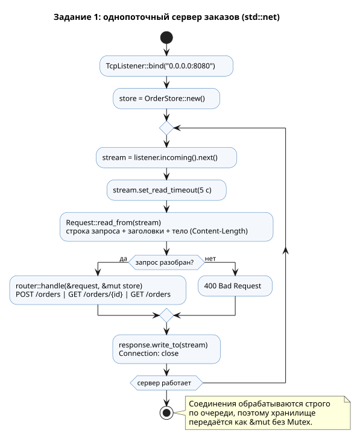
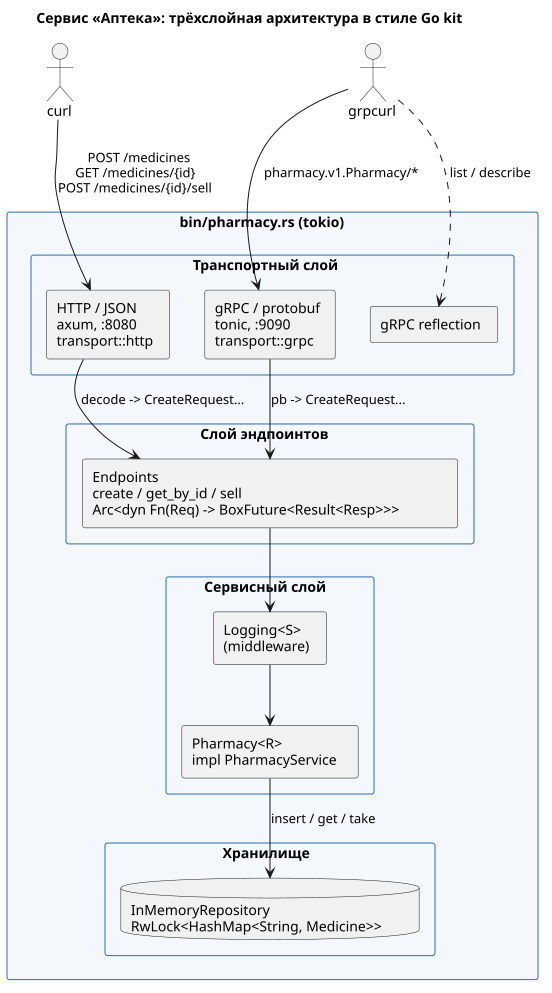
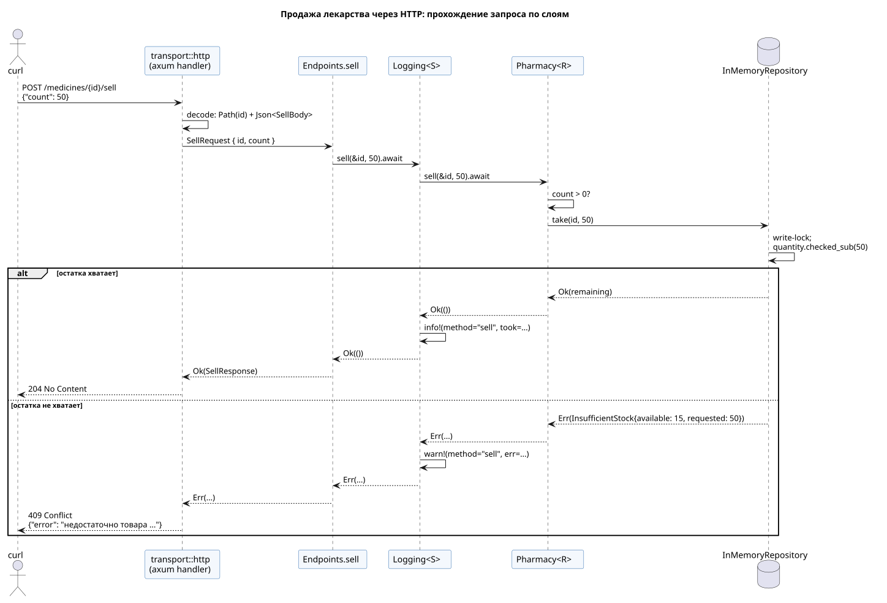

**Имя студента:** Цароев Альберт Казебкович\
**Группа:** ПИЖ-б-о-23-1(1)\
**Предмет:** Контейнерные технологии и DevOps для ИТ-специалистов\
**Претендую на оценку:** Отлично

# Лабораторная работа №6. Микросервисы: HTTP и gRPC

## Цель работы

Изучить построение микросервиса с разделением на слои (сервис, эндпоинты,
транспорт, хранилище) по образцу архитектуры Go kit и научиться выставлять
один и тот же сервис наружу через несколько транспортов — HTTP/JSON и gRPC.
Работа выполнена на Rust: вместо Go kit используются axum (HTTP), tonic (gRPC)
и tokio (асинхронный рантайм).

## Задание

1. **Базовое.** Повторить пример: создать структуру проекта, собрать и
   запустить сервис, проверить все три эндпоинта через curl, убедиться, что
   данные сохраняются между запросами (в памяти). Проверка —
   `localhost:8080/orders/1`.
2. **Свой сервис по варианту.** Реализовать микросервис по варианту в
   трёхслойной архитектуре Go kit: сервисный слой (интерфейс + реализация),
   эндпоинты, HTTP-транспорт, in-memory репозиторий.
3. **Второй транспорт — gRPC.** Выставить тот же сервис одновременно через
   HTTP на `:8080` и gRPC на `:9090`: описать `.proto`, сгенерировать код,
   реализовать gRPC-транспорт, запустить оба транспорта параллельно, проверить
   через grpcurl.

**Вариант 10. Сервис «Аптека».** Сущность `Medicine`: ID, Name, Manufacturer,
Price float64, Prescription bool, Quantity int. Методы сервиса:

```go
Create(ctx, medicine Medicine) (string, error)
GetByID(ctx, id string) (Medicine, error)
Sell(ctx, id string, count int) error
```

## Ход работы

### Структура крейта

```text
lb6/
├── Cargo.toml
├── Dockerfile                 — многоэтапная сборка образа (ЛР 7, ЛР 8)
├── build.rs                   — генерация gRPC-кода из .proto
├── proto/pharmacy.proto       — контракт gRPC-сервиса
├── scripts/
│   ├── demo_orders.sh         — проверка задания 1 через curl
│   └── demo_pharmacy.sh       — проверка заданий 2–3 через curl и grpcurl
├── src/
│   ├── lib.rs
│   ├── bin/
│   │   ├── orders.rs          — задание 1: cargo run -p lb6 --bin orders
│   │   └── pharmacy.rs        — задания 2–3: cargo run -p lb6 --bin pharmacy
│   ├── orders/                — задание 1
│   │   ├── mod.rs             — цикл обработки соединений
│   │   ├── http.rs            — разбор HTTP/1.1 и формирование ответа
│   │   ├── router.rs          — маршрутизация
│   │   └── store.rs           — in-memory хранилище заказов
│   └── pharmacy/              — задания 2–3
│       ├── model.rs           — Medicine
│       ├── error.rs           — ошибки бизнес-логики
│       ├── repository.rs      — трейт MedicineRepository + InMemoryRepository
│       ├── service.rs         — трейт PharmacyService, Pharmacy, Logging
│       ├── endpoint.rs        — Endpoint, Endpoints
│       └── transport/
│           ├── http.rs        — axum
│           └── grpc.rs        — tonic
└── tests/                     — интеграционные тесты транспортов
```

Один крейт содержит два бинарника: `orders` (задание 1) и `pharmacy`
(задания 2–3), которые используют общую библиотеку.

### Задание 1. Базовый HTTP-сервис заказов

По рекомендации задание выполнено без веб-фреймворка, на «голом»
`std::net::TcpListener`, по мотивам главы 21.1 Rust Book «Building a
Single-Threaded Web Server» (до появления пула потоков). Пример из книги
расширен разбором заголовков и тела запроса (`Content-Length`), JSON-ответами и
маршрутизацией.



Эндпоинты:

| Метод | Путь           | Описание                 | Ответ               |
|-------|----------------|--------------------------|---------------------|
| POST  | `/orders`      | создать заказ            | 201 + заказ         |
| GET   | `/orders/{id}` | получить заказ по id     | 200 + заказ / 404   |
| GET   | `/orders`      | список всех заказов      | 200 + массив        |

Маршрутизация — сопоставление кортежа «метод + сегменты пути» с образцами:

```rust
pub fn handle(req: &Request, store: &mut OrderStore) -> Response {
    let segments: Vec<&str> = req.path.trim_matches('/').split('/').collect();
    match (req.method.as_str(), segments.as_slice()) {
        ("POST", ["orders"]) => create(req, store),
        ("GET", ["orders"]) => Response::json(Status::OK, &store.list()),
        ("GET", ["orders", id]) => match id.parse::<u64>() {
            Ok(id) => match store.get(id) {
                Some(order) => Response::json(Status::OK, order),
                None => Response::error(Status::NOT_FOUND, &format!("заказ {id} не найден")),
            },
            Err(_) => Response::error(
                Status::BAD_REQUEST,
                "идентификатор заказа должен быть числом",
            ),
        },
        (_, ["orders"] | ["orders", _]) => {
            Response::error(Status::METHOD_NOT_ALLOWED, "метод не поддерживается")
        }
        _ => Response::error(Status::NOT_FOUND, "маршрут не найден"),
    }
}
```

Сервер однопоточный: соединения обрабатываются по очереди, поэтому хранилище
передаётся обычной изменяемой ссылкой `&mut OrderStore` без `Mutex`. Это
наглядно показывает, что даёт модель заимствований: попытка обработать
соединения в нескольких потоках без синхронизации просто не скомпилируется.
Чтобы один «молчащий» клиент не заблокировал сервер навсегда, на сокет
ставится тайм-аут чтения 5 секунд, а размер тела ограничен 1 МиБ. Функция
`handle` не зависит от сокетов, поэтому покрыта модульными тестами напрямую.

Идентификаторы заказов выдаются последовательно с 1, поэтому первый созданный
заказ доступен по адресу `localhost:8080/orders/1`, как требует задание.

### Задание 2. Сервис «Аптека» в архитектуре Go kit



Соответствие понятий Go kit и реализации:

| Go kit                              | Rust                                                     |
|-------------------------------------|----------------------------------------------------------|
| `type Service interface`            | трейт `PharmacyService`                                  |
| реализация сервиса                  | `Pharmacy<R: MedicineRepository>`                        |
| service middleware (logging)        | `Logging<S: PharmacyService>`                            |
| `endpoint.Endpoint`                 | `Arc<dyn Fn(Req) -> BoxFuture<Result<Resp, Error>>>`     |
| `httptransport.NewServer(e, dec, enc)` | обработчики axum: экстракторы `Path`/`Json` + `IntoResponse` |
| `grpctransport.NewServer(e, dec, enc)` | реализация сгенерированного трейта tonic              |
| `ctx context.Context`               | не нужен: отмена — удаление future, тайм-аут — `tokio::time::timeout` |

**Сервисный слой.** Интерфейс — трейт с асинхронными методами. Возвращаемые
future явно помечены `Send`, чтобы их можно было выполнять на многопоточном
рантайме:

```rust
pub trait PharmacyService: Send + Sync + 'static {
    fn create(&self, medicine: Medicine) -> impl Future<Output = Result<String, Error>> + Send;
    fn get_by_id(&self, id: &str) -> impl Future<Output = Result<Medicine, Error>> + Send;
    fn sell(&self, id: &str, count: u32) -> impl Future<Output = Result<(), Error>> + Send;
}

impl<R: MedicineRepository> PharmacyService for Pharmacy<R> {
    async fn create(&self, mut medicine: Medicine) -> Result<String, Error> {
        validate(&medicine)?;
        if medicine.id.trim().is_empty() {
            medicine.id = uuid::Uuid::new_v4().to_string();
        }
        let id = medicine.id.clone();
        self.repo.insert(medicine)?;
        Ok(id)
    }

    async fn get_by_id(&self, id: &str) -> Result<Medicine, Error> {
        self.repo.get(id)
    }

    async fn sell(&self, id: &str, count: u32) -> Result<(), Error> {
        if count == 0 {
            return Err(Error::InvalidArgument(
                "count должно быть больше нуля".into(),
            ));
        }
        self.repo.take(id, count).map(drop)
    }
}
```

Бизнес-правила: `name` и `manufacturer` не пустые, `price` — конечное
положительное число, `count > 0`; идентификатор генерируется (UUID v4), если
клиент его не передал. `Quantity` и `count` имеют тип `u32`, поэтому
отрицательный остаток невозможен на уровне типов, а отрицательное `count` в
JSON отклоняется ещё при десериализации.

**Репозиторий.** `InMemoryRepository` хранит `HashMap` под `RwLock`. Продажа —
это условное обновление «проверить остаток и списать», которое выполняется
атомарно под одной блокировкой записи (аналог SQL
`UPDATE … SET qty = qty - $1 WHERE id = $2 AND qty >= $1`). Тест
`concurrent_takes_never_oversell` запускает 100 потоков, продающих по одной
единице из 50, и проверяет, что продано ровно 50.

**Middleware.** `Logging<S>` оборачивает любой `PharmacyService` и пишет в лог
метод, аргументы, длительность и ошибку — так же, как `loggingMiddleware` из
примеров Go kit. Слои собираются в `main`:
`Endpoints::new(Logging::new(Pharmacy::new(InMemoryRepository::default())))`.

**Эндпоинты.** Эндпоинт — асинхронная функция «запрос → ответ», которая ничего
не знает о транспорте. Общий конструктор упаковывает замыкание над сервисом:

```rust
fn endpoint<S, Req, Resp, F, Fut>(svc: Arc<S>, f: F) -> Endpoint<Req, Resp>
where
    S: PharmacyService,
    F: Fn(Arc<S>, Req) -> Fut + Send + Sync + 'static,
    Fut: Future<Output = Result<Resp, Error>> + Send + 'static,
{
    Arc::new(move |req| Box::pin(f(Arc::clone(&svc), req)))
}

pub fn make_sell_endpoint<S: PharmacyService>(svc: Arc<S>) -> Endpoint<SellRequest, SellResponse> {
    endpoint(svc, |svc, req: SellRequest| async move {
        svc.sell(&req.id, req.count).await?;
        Ok(SellResponse)
    })
}
```

**HTTP-транспорт.** Роль `decodeRequest` из Go kit выполняют экстракторы
axum, роль `encodeResponse` — типы, реализующие `IntoResponse`. Ошибки
сервиса отображаются в HTTP-статусы в одном месте:

```rust
pub fn router(endpoints: Endpoints) -> Router {
    Router::new()
        .route("/medicines", post(create))
        .route("/medicines/{id}", get(get_by_id))
        .route("/medicines/{id}/sell", post(sell))
        .route("/health", get(|| async { Json(json!({"status": "ok"})) }))
        .with_state(endpoints)
}

async fn sell(
    State(e): State<Endpoints>,
    Path(id): Path<String>,
    body: Result<Json<SellBody>, JsonRejection>,
) -> Result<StatusCode, HttpError> {
    let Json(SellBody { count }) = body?;
    (e.sell)(SellRequest { id, count }).await?;
    Ok(StatusCode::NO_CONTENT)
}

impl From<Error> for HttpError {
    fn from(err: Error) -> Self {
        let status = match err {
            Error::NotFound(_) => StatusCode::NOT_FOUND,
            Error::AlreadyExists(_) | Error::InsufficientStock { .. } => StatusCode::CONFLICT,
            Error::InvalidArgument(_) => StatusCode::BAD_REQUEST,
        };
        Self { status, message: err.to_string() }
    }
}
```

| Метод | Путь                     | Эндпоинт    | Успех                  | Ошибки        |
|-------|--------------------------|-------------|------------------------|---------------|
| POST  | `/medicines`             | `create`    | 201 `{"id": "…"}`      | 400, 409, 422 |
| GET   | `/medicines/{id}`        | `get_by_id` | 200 `Medicine`         | 404           |
| POST  | `/medicines/{id}/sell`   | `sell`      | 204 No Content         | 400, 404, 409, 422 |
| GET   | `/health`                | —           | 200 `{"status":"ok"}`  | —             |

Эндпоинт `/health` добавлен для проверок готовности в Docker и CI (ЛР 7, ЛР 8).

Путь запроса продажи через все слои:



### Задание 3. Второй транспорт — gRPC

**Контракт** описан в `proto/pharmacy.proto`:

```protobuf
syntax = "proto3";

package pharmacy.v1;

service Pharmacy {
  rpc Create(CreateRequest) returns (CreateResponse);
  rpc GetByID(GetByIDRequest) returns (GetByIDResponse);
  rpc Sell(SellRequest) returns (SellResponse);
}

message Medicine {
  string id = 1;
  string name = 2;
  string manufacturer = 3;
  double price = 4;
  bool prescription = 5;
  uint32 quantity = 6;
}

message CreateRequest { Medicine medicine = 1; }
message CreateResponse { string id = 1; }
message GetByIDRequest { string id = 1; }
message GetByIDResponse { Medicine medicine = 1; }
message SellRequest { string id = 1; uint32 count = 2; }
message SellResponse {}
```

**Генерация кода.** Вместо ручного вызова `protoc` (шаг «сгенерировать Go-код
через protoc») код генерируется автоматически при каждой сборке в `build.rs`.
Сам `.proto` компилируется библиотекой `protox` — компилятором Protocol
Buffers на чистом Rust, поэтому для сборки не нужен установленный `protoc` ни
локально, ни в CI, ни в Docker-образе. Дескриптор сохраняется отдельно для
gRPC reflection.

```rust
fn main() -> Result<(), Box<dyn std::error::Error>> {
    println!("cargo:rerun-if-changed={PROTO}");

    let fds = protox::compile([PROTO], ["proto"])?;

    // Дескриптор нужен серверу gRPC reflection (его использует grpcurl).
    let out_dir = PathBuf::from(env::var("OUT_DIR")?);
    fs::write(out_dir.join("pharmacy_descriptor.bin"), fds.encode_to_vec())?;

    tonic_prost_build::configure().compile_fds(fds)?;
    Ok(())
}
```

**gRPC-транспорт** реализует сгенерированный трейт `Pharmacy`: декодирует
protobuf-сообщение в запрос эндпоинта, вызывает **тот же** эндпоинт, что и HTTP,
и кодирует ответ. Ошибки отображаются в коды gRPC:

```rust
impl From<Error> for Status {
    fn from(err: Error) -> Self {
        let msg = err.to_string();
        match err {
            Error::NotFound(_) => Status::not_found(msg),
            Error::AlreadyExists(_) => Status::already_exists(msg),
            Error::InvalidArgument(_) => Status::invalid_argument(msg),
            Error::InsufficientStock { .. } => Status::failed_precondition(msg),
        }
    }
}

#[tonic::async_trait]
impl Pharmacy for GrpcServer {
    // create, get_by_id аналогично
    async fn sell(
        &self,
        request: Request<pb::SellRequest>,
    ) -> Result<Response<pb::SellResponse>, Status> {
        let pb::SellRequest { id, count } = request.into_inner();
        (self.endpoints.sell)(SellRequest { id, count }).await?;
        Ok(Response::new(pb::SellResponse {}))
    }
}
```

Дополнительно подключён сервис gRPC Server Reflection, поэтому `grpcurl`
получает описание сервиса прямо с сервера, без `.proto`-файла.

**Запуск обоих транспортов.** В `main` оба сервера работают параллельно на
одном рантайме tokio и разделяют один набор эндпоинтов (а значит, одно
хранилище). Общий сигнал завершения (Ctrl+C или SIGTERM, который посылает
`docker stop`) корректно останавливает оба сервера:

```rust
let http_listener = TcpListener::bind(&http_addr).await?;
let grpc_listener = TcpListener::bind(&grpc_addr).await?;

let http_server = axum::serve(http_listener, http::router(endpoints.clone()))
    .with_graceful_shutdown(stopped(stop_rx.clone()));
let grpc_server = tonic::transport::Server::builder()
    .add_service(grpc::server(endpoints))
    .add_service(grpc::reflection_server())
    .serve_with_incoming_shutdown(TcpIncoming::from(grpc_listener), stopped(stop_rx));

let http = async { http_server.await.map_err(BoxError::from) };
let grpc = async { grpc_server.await.map_err(BoxError::from) };
tokio::try_join!(http, grpc)?;
```

Адреса можно переопределить переменными `HTTP_ADDR` и `GRPC_ADDR`, уровень
логов — `RUST_LOG`.

### Тестирование

| Уровень           | Что проверяется                                                        |
|-------------------|------------------------------------------------------------------------|
| модульные         | разбор HTTP, маршрутизатор заказов, репозиторий (в т.ч. 100 конкурентных продаж), правила сервиса, эндпоинты |
| `orders_tcp`      | сервер заказов через настоящий TCP-сокет: данные сохраняются между запросами |
| `pharmacy_http`   | маршрутизатор axum без сети (`tower::ServiceExt::oneshot`): сценарий и коды ошибок |
| `pharmacy_grpc`   | реальный gRPC-сервер на случайном порту + сгенерированный клиент tonic |

## Результаты

### Задание 1: сервер заказов

```bash
$ cargo run -p lb6 --bin orders
order-service слушает http://0.0.0.0:8080
```

Проверка всех трёх эндпоинтов (`lb6/scripts/demo_orders.sh`):

```bash
$ curl -s -X POST http://localhost:8080/orders -H 'Content-Type: application/json' -d '{"customer":"Альберт","item":"Ноутбук","quantity":1}'
{"id":1,"customer":"Альберт","item":"Ноутбук","quantity":1}

$ curl -s -X POST http://localhost:8080/orders -H 'Content-Type: application/json' -d '{"customer":"Мария","item":"Монитор","quantity":2}'
{"id":2,"customer":"Мария","item":"Монитор","quantity":2}

$ curl -s -i http://localhost:8080/orders/1
HTTP/1.1 200 OK
Content-Type: application/json
Content-Length: 73
Connection: close

{"id":1,"customer":"Альберт","item":"Ноутбук","quantity":1}

$ curl -s http://localhost:8080/orders
[{"id":1,"customer":"Альберт","item":"Ноутбук","quantity":1},{"id":2,"customer":"Мария","item":"Монитор","quantity":2}]

$ curl -s -i http://localhost:8080/orders/42
HTTP/1.1 404 Not Found
Content-Type: application/json
Content-Length: 43
Connection: close

{"error":"заказ 42 не найден"}

$ curl -s -X POST http://localhost:8080/orders -H 'Content-Type: application/json' -d '{"customer":"Олег"}'
{"error":"некорректный JSON: missing field `item` at line 1 column 23"}
```

Лог сервера:

```text
order-service слушает http://0.0.0.0:8080
POST /orders -> 201
POST /orders -> 201
GET /orders/1 -> 200
GET /orders -> 200
GET /orders/42 -> 404
POST /orders -> 400
```

Заказ `id=1`, созданный первым запросом, возвращается последующими запросами
`GET /orders/1` и `GET /orders`: данные сохраняются в памяти между запросами.

### Задания 2–3: сервис «Аптека», HTTP :8080

```bash
$ cargo run -p lb6 --bin pharmacy
```

Проверка (`lb6/scripts/demo_pharmacy.sh`), HTTP-часть:

```bash
$ curl -s -X POST http://localhost:8080/medicines -H 'Content-Type: application/json' -d '{"name":"Парацетамол","manufacturer":"Фармстандарт","price":45.9,"prescription":false,"quantity":100}'
{"id":"988b381c-f47f-49e2-9fdc-8d0842f6795a"}

$ ID=$(curl -s -X POST http://localhost:8080/medicines ... | jq -r .id)
$ echo $ID
1baf9116-81dd-4c79-9a3a-df4f655cc7a4

$ curl -s http://localhost:8080/medicines/1baf9116-81dd-4c79-9a3a-df4f655cc7a4
{"id":"1baf9116-81dd-4c79-9a3a-df4f655cc7a4","name":"Амоксициллин","manufacturer":"Sandoz","price":245.0,"prescription":true,"quantity":20}

$ curl -s -i -X POST http://localhost:8080/medicines/1baf9116-81dd-4c79-9a3a-df4f655cc7a4/sell -H 'Content-Type: application/json' -d '{"count":5}'
HTTP/1.1 204 No Content
date: Thu, 22 Oct 2026 06:13:45 GMT

$ curl -s http://localhost:8080/medicines/1baf9116-81dd-4c79-9a3a-df4f655cc7a4
{"id":"1baf9116-81dd-4c79-9a3a-df4f655cc7a4","name":"Амоксициллин","manufacturer":"Sandoz","price":245.0,"prescription":true,"quantity":15}

$ curl -s -i -X POST http://localhost:8080/medicines/1baf9116-81dd-4c79-9a3a-df4f655cc7a4/sell -H 'Content-Type: application/json' -d '{"count":50}'
HTTP/1.1 409 Conflict
content-type: application/json
content-length: 131
date: Thu, 22 Oct 2026 06:13:45 GMT

{"error":"недостаточно товара 1baf9116-81dd-4c79-9a3a-df4f655cc7a4: в наличии 15, запрошено 50"}

$ curl -s -i http://localhost:8080/medicines/no-such-id
HTTP/1.1 404 Not Found
content-type: application/json
content-length: 61
date: Thu, 22 Oct 2026 06:13:45 GMT

{"error":"лекарство no-such-id не найдено"}

$ curl -s -X POST http://localhost:8080/medicines -H 'Content-Type: application/json' -d '{"name":"","manufacturer":"X","price":-1,"quantity":1}'
{"error":"некорректные данные: name не должно быть пустым"}
```

### Задание 3: gRPC :9090 через grpcurl

```bash
$ grpcurl -plaintext localhost:9090 list
grpc.reflection.v1.ServerReflection
pharmacy.v1.Pharmacy

$ grpcurl -plaintext localhost:9090 describe pharmacy.v1.Pharmacy
pharmacy.v1.Pharmacy is a service:
// Сервис «Аптека» (вариант 10).
service Pharmacy {
  // Добавляет лекарство и возвращает присвоенный идентификатор.
  rpc Create ( .pharmacy.v1.CreateRequest ) returns ( .pharmacy.v1.CreateResponse );
  // Возвращает лекарство по идентификатору.
  rpc GetByID ( .pharmacy.v1.GetByIDRequest ) returns ( .pharmacy.v1.GetByIDResponse );
  // Продаёт count единиц лекарства, уменьшая остаток.
  rpc Sell ( .pharmacy.v1.SellRequest ) returns ( .pharmacy.v1.SellResponse );
}

$ grpcurl -plaintext -d '{"medicine":{"id":"ins-100","name":"Инсулин","manufacturer":"Novo Nordisk","price":1290,"prescription":true,"quantity":10}}' localhost:9090 pharmacy.v1.Pharmacy/Create
{
  "id": "ins-100"
}

$ grpcurl -plaintext -d '{"id":"ins-100","count":3}' localhost:9090 pharmacy.v1.Pharmacy/Sell
{}

$ grpcurl -plaintext -d '{"id":"ins-100"}' localhost:9090 pharmacy.v1.Pharmacy/GetByID
{
  "medicine": {
    "id": "ins-100",
    "name": "Инсулин",
    "manufacturer": "Novo Nordisk",
    "price": 1290,
    "prescription": true,
    "quantity": 7
  }
}

$ grpcurl -plaintext -d '{"id":"1baf9116-81dd-4c79-9a3a-df4f655cc7a4"}' localhost:9090 pharmacy.v1.Pharmacy/GetByID
{
  "medicine": {
    "id": "1baf9116-81dd-4c79-9a3a-df4f655cc7a4",
    "name": "Амоксициллин",
    "manufacturer": "Sandoz",
    "price": 245,
    "prescription": true,
    "quantity": 15
  }
}

$ curl -s http://localhost:8080/medicines/ins-100
{"id":"ins-100","name":"Инсулин","manufacturer":"Novo Nordisk","price":1290.0,"prescription":true,"quantity":7}

$ grpcurl -plaintext -d '{"id":"ins-100","count":100}' localhost:9090 pharmacy.v1.Pharmacy/Sell
ERROR:
  Code: FailedPrecondition
  Message: недостаточно товара ins-100: в наличии 7, запрошено 100

$ grpcurl -plaintext -d '{"id":"nope"}' localhost:9090 pharmacy.v1.Pharmacy/GetByID
ERROR:
  Code: NotFound
  Message: лекарство nope не найдено
```

Лекарство, созданное через HTTP, читается через gRPC, и наоборот: оба транспорта
работают с одним сервисом и одним хранилищем.

### Лог сервиса

Логи пишет middleware `Logging`. В конце виден корректный останов по SIGTERM.

```text
2026-10-22T06:13:45.134596Z  INFO pharmacy: HTTP-транспорт слушает http://0.0.0.0:8080
2026-10-22T06:13:45.134828Z  INFO pharmacy: gRPC-транспорт слушает 0.0.0.0:9090
2026-10-22T06:13:45.845551Z  INFO lb6::pharmacy::service: ok method="create" args="Парацетамол" took=23.806µs
2026-10-22T06:13:45.853236Z  INFO lb6::pharmacy::service: ok method="create" args="Амоксициллин" took=18.97µs
2026-10-22T06:13:45.860539Z  INFO lb6::pharmacy::service: ok method="get_by_id" args="1baf9116-81dd-4c79-9a3a-df4f655cc7a4" took=9.115µs
2026-10-22T06:13:45.868132Z  INFO lb6::pharmacy::service: ok method="sell" args=("1baf9116-81dd-4c79-9a3a-df4f655cc7a4", 5) took=8.401µs
2026-10-22T06:13:45.876538Z  INFO lb6::pharmacy::service: ok method="get_by_id" args="1baf9116-81dd-4c79-9a3a-df4f655cc7a4" took=9.12µs
2026-10-22T06:13:45.883468Z  WARN lb6::pharmacy::service: error method="sell" args=("1baf9116-81dd-4c79-9a3a-df4f655cc7a4", 50) took=7.25µs err=недостаточно товара 1baf9116-81dd-4c79-9a3a-df4f655cc7a4: в наличии 15, запрошено 50
2026-10-22T06:13:45.890542Z  WARN lb6::pharmacy::service: error method="get_by_id" args="no-such-id" took=6.076µs err=лекарство no-such-id не найдено
2026-10-22T06:13:45.897273Z  WARN lb6::pharmacy::service: error method="create" args="" took=3.181µs err=некорректные данные: name не должно быть пустым
2026-10-22T06:13:46.099060Z  INFO lb6::pharmacy::service: ok method="create" args="Инсулин" took=11.422µs
2026-10-22T06:13:46.152694Z  INFO lb6::pharmacy::service: ok method="sell" args=("ins-100", 3) took=8.707µs
2026-10-22T06:13:46.251980Z  INFO lb6::pharmacy::service: ok method="get_by_id" args="ins-100" took=9.81µs
2026-10-22T06:13:46.348939Z  INFO lb6::pharmacy::service: ok method="get_by_id" args="1baf9116-81dd-4c79-9a3a-df4f655cc7a4" took=9.923µs
2026-10-22T06:13:46.399805Z  INFO lb6::pharmacy::service: ok method="get_by_id" args="ins-100" took=10.468µs
2026-10-22T06:13:46.456188Z  WARN lb6::pharmacy::service: error method="sell" args=("ins-100", 100) took=9.663µs err=недостаточно товара ins-100: в наличии 7, запрошено 100
2026-10-22T06:13:46.513664Z  WARN lb6::pharmacy::service: error method="get_by_id" args="nope" took=7.5µs err=лекарство nope не найдено
2026-10-22T06:13:46.517162Z  INFO pharmacy: получен сигнал завершения, останавливаем серверы
2026-10-22T06:13:46.517310Z  INFO pharmacy: серверы остановлены
```

### Тесты

```bash
$ cargo test -p lb6
     Running unittests src/lib.rs (target/debug/deps/lb6-…)

running 14 tests
test orders::http::tests::parses_get_without_body ... ok
test orders::http::tests::parses_post_with_body ... ok
test orders::http::tests::writes_response ... ok
test orders::http::tests::rejects_garbage ... ok
test orders::router::tests::create_get_list_roundtrip ... ok
test pharmacy::repository::tests::errors ... ok
test pharmacy::endpoint::tests::endpoints_call_the_service ... ok
test pharmacy::repository::tests::insert_get_take ... ok
test orders::router::tests::error_responses ... ok
test pharmacy::service::tests::create_assigns_uuid_and_get_returns_it ... ok
test pharmacy::service::tests::create_keeps_client_id_and_rejects_duplicates ... ok
test pharmacy::service::tests::create_validates_input ... ok
test pharmacy::service::tests::sell_decrements_and_checks_stock ... ok
test pharmacy::repository::tests::concurrent_takes_never_oversell ... ok

test result: ok. 14 passed; 0 failed; 0 ignored; 0 measured; 0 filtered out; finished in 0.00s

     Running tests/orders_tcp.rs (target/debug/deps/orders_tcp-…)

running 1 test
test data_persists_between_requests ... ok

test result: ok. 1 passed; 0 failed; 0 ignored; 0 measured; 0 filtered out; finished in 0.00s

     Running tests/pharmacy_grpc.rs (target/debug/deps/pharmacy_grpc-…)

running 2 tests
test errors_map_to_grpc_codes ... ok
test create_get_sell ... ok

test result: ok. 2 passed; 0 failed; 0 ignored; 0 measured; 0 filtered out; finished in 0.01s

     Running tests/pharmacy_http.rs (target/debug/deps/pharmacy_http-…)

running 3 tests
test health ... ok
test full_scenario ... ok
test error_mapping ... ok

test result: ok. 3 passed; 0 failed; 0 ignored; 0 measured; 0 filtered out; finished in 0.00s
```

## Вывод

Все три задания выполнены:

1. Базовый сервис заказов на `std::net` обрабатывает три эндпоинта и хранит
   данные в памяти между запросами; проверено через curl и интеграционным
   тестом с настоящим сокетом.
2. Сервис «Аптека» (вариант 10) построен по трёхслойной архитектуре Go kit:
   трейт сервиса и его реализация, middleware логирования, эндпоинты как
   независимые от транспорта функции, HTTP-транспорт и потокобезопасный
   in-memory репозиторий с атомарной продажей.
3. Тот же сервис одновременно доступен по HTTP (`:8080`) и gRPC (`:9090`).
   Контракт описан в `.proto`, код генерируется при сборке без внешнего
   `protoc`, проверка выполнена через grpcurl с использованием reflection.

Архитектура Go kit хорошо переносится на Rust. Трейты и обобщения
(`Pharmacy<R>`, `Logging<S>`) дают ту же заменяемость слоёв, что интерфейсы Go,
но со статической диспетчеризацией. Ошибки описаны одним перечислением, и
компилятор проверяет, что каждый транспорт обработал все варианты при
отображении в HTTP-статусы и коды gRPC. Добавление второго транспорта не
потребовало изменений в сервисе и эндпоинтах — это и есть главное преимущество
разделения на слои. 20 автоматических тестов на всех уровнях (от разбора HTTP
до gRPC-клиента) служат основой для CI в ЛР 7.
