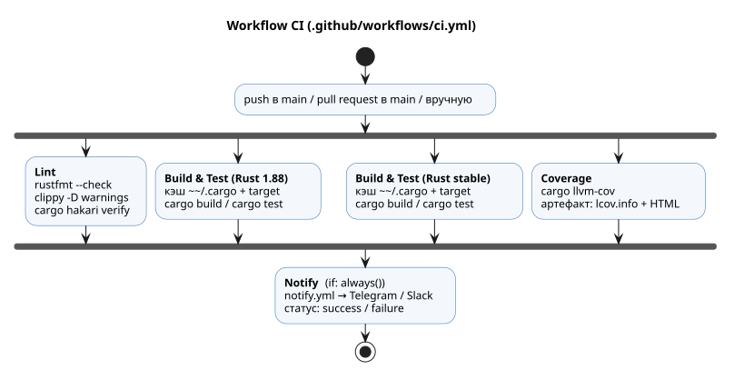
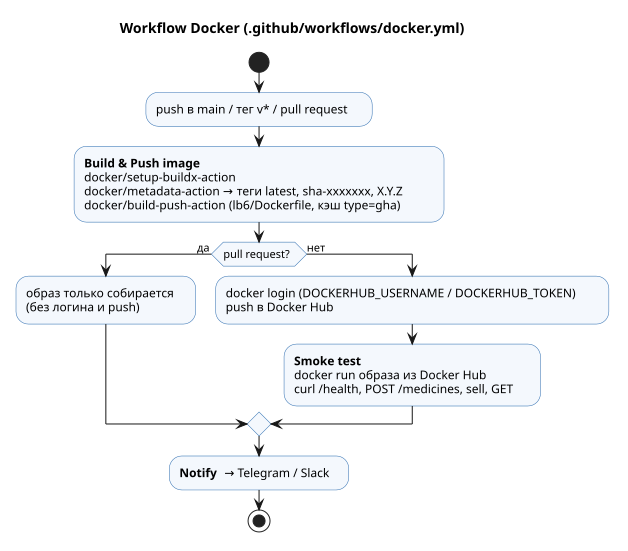
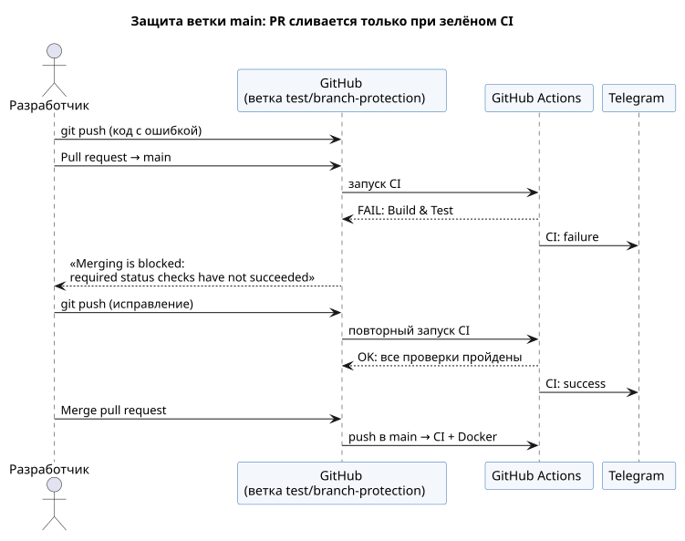

**Имя студента:** Цароев Альберт Казебкович\
**Группа:** ПИЖ-б-о-23-1(1)\
**Предмет:** Контейнерные технологии и DevOps для ИТ-специалистов\
**Претендую на оценку:** Отлично

# Лабораторная работа №7. CI/CD для микросервиса на GitHub Actions

[](https://github.com/Wildcat2k21/method_devops_labs/actions/workflows/ci.yml)
[](https://github.com/Wildcat2k21/method_devops_labs/actions/workflows/docker.yml)

## Цель работы

Изучить принципы непрерывной интеграции и непрерывной доставки (CI/CD), освоить
синтаксис GitHub Actions и настроить автоматическую сборку, тестирование,
линтинг, измерение покрытия и публикацию Docker-образа для микросервиса из
ЛР 6. Сервис написан на Rust, поэтому инструменты Go заменены их аналогами.

## Задание

1. **Базовое.** Загрузить проект ЛР 6 на GitHub, создать
   `.github/workflows/ci.yml` со сборкой и тестами, убедиться в запуске на push
   и PR, найти в логах шаги Build и Test, добавить бейдж статуса в README.
2. **Матрица и линтинг.** Матричная сборка на двух версиях компилятора, шаг
   линтера, коммит с намеренной ошибкой, которую ловит линтер.
3. **Docker-образ.** Multi-stage Dockerfile, `.github/workflows/docker.yml`,
   секреты `DOCKERHUB_USERNAME` и `DOCKERHUB_TOKEN`, публикация в Docker Hub,
   локальный запуск скачанного образа.
4. **Защита ветки.** Branch protection для `main`, PR из тестовой ветки, мерж
   заблокирован до прохождения CI, исправление и мерж.
5. **Кэширование и артефакты.** Кэш зависимостей, сравнение времени первого и
   второго запуска, отчёт о покрытии как artifact, просмотр локально.

**Вариант 10. Уведомления:** отправка статуса сборки в Telegram и/или Slack
через соответствующие actions.

## Ход работы

### Соответствие инструментов Go и Rust

| В задании (Go)                      | В работе (Rust)                                              |
|-------------------------------------|--------------------------------------------------------------|
| `go build ./...`, `go test ./...`   | `cargo build --workspace`, `cargo test --workspace`          |
| матрица Go 1.21 / 1.22              | матрица Rust 1.88 (MSRV, `rust-version`) / stable            |
| `golangci-lint`                     | `cargo clippy -D warnings` + `cargo fmt --check` + `cargo hakari verify` |
| кэш `~/go/pkg/mod`                  | кэш `~/.cargo/registry`, `~/.cargo/git`, `target/`           |
| `go test -coverprofile=coverage.out`| `cargo llvm-cov` → `lcov.info` + HTML-отчёт                  |
| `go tool cover -html=coverage.out`  | открыть `coverage/html/index.html` из артефакта              |

Основная ветка репозитория — `master` (в тексте задания — `main`; роль та же),
поэтому триггеры workflow и защита настроены для `master`.

### Расположение файлов

Весь воркспейс (ЛР 1–8) хранится в одном репозитории. Поэтому workflow лежат
в корне, а CI проверяет сразу все крейты, в том числе сервис ЛР 6:

```text
.github/workflows/
├── ci.yml        — сборка, тесты, линтинг, покрытие (задания 1, 2, 5)
├── docker.yml    — сборка и публикация образа (задание 3)
└── notify.yml    — переиспользуемый workflow уведомлений (вариант 10)
lb6/Dockerfile    — multi-stage сборка сервиса
.dockerignore     — исключение target/, .git и документации из контекста
lb7/demo/
├── lint-error.patch     — намеренная ошибка для линтера (задание 2)
└── failing-test.patch   — баг, ломающий тест, для проверки защиты ветки (задание 4)
```

### Задание 1. Базовый CI



Workflow запускается на `push` в `master`, на каждый pull request в `master` и
вручную (`workflow_dispatch`). Блок `concurrency` отменяет устаревший запуск
при новом пуше в ту же ветку, а `permissions: contents: read` даёт токену
минимальные права.

```yaml
name: CI

on:
  push:
    branches: [master]
  pull_request:
    branches: [master]
  workflow_dispatch:

concurrency:
  group: ci-${{ github.ref }}
  cancel-in-progress: true

permissions:
  contents: read

env:
  CARGO_TERM_COLOR: always
```

Шаги **Build** и **Test** выделены отдельно, чтобы их было легко найти в логах:

```yaml
      - name: Build
        run: cargo build --workspace --all-targets --locked

      - name: Test
        run: cargo test --workspace --locked
```

Флаг `--locked` запрещает менять `Cargo.lock` во время сборки: CI собирает ровно
те версии зависимостей, что зафиксированы в репозитории.

Бейдж статуса добавлен в начало этого отчёта и в корневой `README.md`:

```markdown
[](https://github.com/Wildcat2k21/method_devops_labs/actions/workflows/ci.yml)
```

[ЗАПОЛНИТЬ ПОСЛЕ ЗАПУСКА В GITHUB: список запусков на push и на PR, лог шагов Build и Test]

### Задание 2. Матрица и линтинг

```yaml
  test:
    name: Build & Test (Rust ${{ matrix.rust }})
    runs-on: ubuntu-latest
    strategy:
      fail-fast: false
      matrix:
        rust: ["1.88", stable]
    steps:
      - uses: actions/checkout@v7
      - uses: dtolnay/rust-toolchain@master
        with:
          toolchain: ${{ matrix.rust }}
```

Версия 1.88 — минимально поддерживаемая версия (MSRV), указанная в
`rust-version` корневого `Cargo.toml`: этого требуют tonic 0.14 и
edition 2024. Резолвер зависимостей v3 учитывает `rust-version` и подбирает
совместимые версии крейтов, поэтому матрица проверяет, что проект собирается и
на самом старом поддерживаемом компиляторе, и на актуальном. `fail-fast: false`
не даёт падению одной ячейки матрицы отменить другую.

Совместимость с 1.88 проверена локально до отправки в CI:

```bash
$ cargo +1.88 --version
cargo 1.88.0 (873a06493 2025-05-10)
$ CARGO_TARGET_DIR=target/msrv cargo +1.88 test --workspace --locked
...
passed=73 failed=0
```

Линтинг вынесен в отдельный job **Lint**: `cargo fmt --check` проверяет
форматирование, `cargo clippy -D warnings` превращает любое предупреждение
компилятора или clippy в ошибку, `cargo hakari verify` проверяет, что крейт
`workspace-hack` соответствует зависимостям воркспейса. Перед отправкой
workflow проверены линтером `actionlint` (включая shellcheck для шагов `run`):

```bash
$ docker run --rm -v "$PWD:/repo" --workdir /repo rhysd/actionlint:1.7.12 -no-color
$ echo $?
0
```

**Намеренная ошибка.** Патч `lb7/demo/lint-error.patch` добавляет
неиспользуемую переменную:

```diff
--- a/lb6/src/pharmacy/service.rs
+++ b/lb6/src/pharmacy/service.rs
@@ -65,6 +65,7 @@
     }
 
     async fn get_by_id(&self, id: &str) -> Result<Medicine, Error> {
+        let cache_hit = false; // намеренная ошибка для ЛР 7: переменная не используется
         self.repo.get(id)
     }
```

Шаг clippy её ловит и завершается с ошибкой:

```bash
$ cargo clippy --workspace --all-targets --locked -- -D warnings
error: unused variable: `cache_hit`
  --> lb6/src/pharmacy/service.rs:68:13
   |
68 |         let cache_hit = false; // намеренная ошибка для ЛР 7: переменная не используется
   |             ^^^^^^^^^ help: if this is intentional, prefix it with an underscore: `_cache_hit`
   |
   = note: `-D unused-variables` implied by `-D warnings`
   = help: to override `-D warnings` add `#[allow(unused_variables)]`

error: could not compile `lb6` (lib) due to 1 previous error
warning: build failed, waiting for other jobs to finish...
error: could not compile `lb6` (lib test) due to 1 previous error
exit code: 101
```

[ЗАПОЛНИТЬ ПОСЛЕ ЗАПУСКА В GITHUB: красный job Lint на коммите с ошибкой и зелёный — после исправления]

### Задание 3. Docker-образ

**Dockerfile** (`lb6/Dockerfile`) — четыре стадии: инструменты (`chef`), «рецепт»
зависимостей (`planner`), сборка (`builder`) и минимальный образ запуска на
Alpine. Слой с зависимостями (`cargo chef cook`) пересобирается только при
изменении `Cargo.toml`/`Cargo.lock`. Бинарник статически слинкован с musl, а
в итоговый образ попадает только он и непривилегированный пользователь `app`.

```dockerfile
ARG RUST_IMAGE=rust:1.99-alpine3.24
ARG RUNTIME_IMAGE=alpine:3.24

FROM ${RUST_IMAGE} AS chef
RUN apk add --no-cache musl-dev \
 && cargo install cargo-chef --locked --version 0.1.78
WORKDIR /src

FROM chef AS planner
COPY . .
RUN cargo chef prepare --recipe-path recipe.json

FROM chef AS builder
COPY --from=planner /src/recipe.json recipe.json
RUN cargo chef cook --release --locked -p lb6 --recipe-path recipe.json
COPY . .
ARG BIN=pharmacy
RUN cargo build --release --locked -p lb6 --bin "${BIN}" \
 && cp "target/release/${BIN}" /usr/local/bin/app

FROM ${RUNTIME_IMAGE}
RUN addgroup -S app && adduser -S -G app app
COPY --from=builder /usr/local/bin/app /usr/local/bin/app
USER app
EXPOSE 8080 9090
ENTRYPOINT ["/usr/local/bin/app"]
```

Размер итогового образа — **20 МБ** (подробный разбор стадий и эффекта
`.dockerignore` — в ЛР 8).



**docker.yml.** Для pull request образ только собирается (проверка, что
Dockerfile не сломан), для `master` и тегов `v*` — собирается и публикуется.
Публикация включается, только если заданы оба секрета Docker Hub (переменная
`PUSH` на уровне job), поэтому в форке или до настройки секретов workflow не
падает на логине, а просто проверяет сборку.
Теги формирует `docker/metadata-action`: `latest` для основной ветки,
`sha-<коммит>` для каждой сборки и `X.Y.Z` для тегов релизов. Кэш слоёв
хранится в кэше GitHub Actions (`type=gha`). После публикации job **Smoke
test** скачивает образ из Docker Hub, запускает контейнер и проверяет
эндпоинты через curl.

```yaml
  image:
    env:
      PUSH: ${{ github.event_name != 'pull_request' && secrets.DOCKERHUB_USERNAME != '' && secrets.DOCKERHUB_TOKEN != '' }}
    steps:
      # ...
      - name: Log in to Docker Hub
        if: env.PUSH == 'true'
        uses: docker/login-action@v4
        with:
          username: ${{ secrets.DOCKERHUB_USERNAME }}
          password: ${{ secrets.DOCKERHUB_TOKEN }}

      - name: Build and push
        uses: docker/build-push-action@v7
        with:
          context: .
          file: lb6/Dockerfile
          push: ${{ env.PUSH == 'true' }}
          tags: ${{ steps.meta.outputs.tags }}
          labels: ${{ steps.meta.outputs.labels }}
          cache-from: type=gha
          cache-to: type=gha,mode=max
```

**Секреты** задаются в *Settings → Secrets and variables → Actions*:
`DOCKERHUB_USERNAME` — логин Docker Hub, `DOCKERHUB_TOKEN` — access token
(*Docker Hub → Account settings → Personal access tokens*, права Read & Write).
Пароль в CI не используется.

[ЗАПОЛНИТЬ ПОСЛЕ ЗАПУСКА В GITHUB: лог push в Docker Hub, страница образа, `docker pull` + `docker run` + curl локально]

### Задание 4. Защита ветки



Настройка: *Settings → Branches → Add branch ruleset* (или *Add classic
branch protection rule*) для `master`:

* **Require a pull request before merging**;
* **Require status checks to pass before merging** с обязательными проверками
  `Lint (rustfmt + clippy)`, `Build & Test (Rust 1.88)`,
  `Build & Test (Rust stable)`, `Coverage`;
* **Require branches to be up to date before merging**.

Сценарий проверки: в ветке `test/branch-protection` применяется патч
`lb7/demo/failing-test.patch`, в котором валидация цены ошибочно пропускает
`price = 0`:

```diff
-    if !(m.price.is_finite() && m.price > 0.0) {
+    if !(m.price.is_finite() && m.price >= 0.0) {
```

Тест ловит регрессию (локальная проверка):

```bash
$ cargo test --workspace --locked
test pharmacy::service::tests::create_validates_input ... FAILED
thread 'pharmacy::service::tests::create_validates_input' panicked at lb6/src/pharmacy/service.rs:191:13:
assertion failed: matches!(svc.create(bad).await, Err(Error::InvalidArgument(_)))
test result: FAILED. 13 passed; 1 failed; 0 ignored; 0 measured; 0 filtered out; finished in 0.00s
error: test failed, to rerun pass `-p lb6 --lib`
```

После открытия PR кнопка мержа заблокирована, пока обязательные проверки не
пройдут. Исправляющий коммит (`git revert`) делает CI зелёным, после чего PR
сливается.

[ЗАПОЛНИТЬ ПОСЛЕ ЗАПУСКА В GITHUB: PR с заблокированным мержем, PR после исправления, история коммитов]

### Задание 5. Кэширование и артефакты

**Кэш.** Аналог `~/go/pkg/mod` в Rust — скачанные исходники крейтов
(`~/.cargo/registry`, `~/.cargo/git`). Кроме того, кэшируется каталог `target/`
со скомпилированными зависимостями, что даёт основной выигрыш: компиляция
tokio, tonic и axum занимает минуты. Ключ кэша включает ОС, версию компилятора
и хэш `Cargo.lock`. При изменении зависимостей используется ближайший кэш по
префиксу `restore-keys`.

```yaml
      - name: Cache cargo
        uses: actions/cache@v6
        with:
          path: |
            ~/.cargo/registry/index/
            ~/.cargo/registry/cache/
            ~/.cargo/git/db/
            target/
          key: ${{ runner.os }}-cargo-${{ matrix.rust }}-${{ hashFiles('**/Cargo.lock') }}
          restore-keys: ${{ runner.os }}-cargo-${{ matrix.rust }}-
```

[ЗАПОЛНИТЬ ПОСЛЕ ЗАПУСКА В GITHUB: время первого (без кэша) и второго (с кэшем) запуска]

**Покрытие** собирается `cargo-llvm-cov` (инструментирование LLVM, точный
построчный учёт) и сохраняется как artifact `coverage`: `lcov.info`
(машиночитаемый формат, аналог `coverage.out`), HTML-отчёт и текстовая сводка,
которая также выводится в Summary запуска. Демонстрационные бинарники
(`main.rs`, `src/bin/`) из отчёта исключены. Тот же отчёт, полученный локально:

```bash
$ cargo llvm-cov --workspace --locked --no-report
$ cargo llvm-cov report --ignore-filename-regex 'src/(main\.rs|bin/)' --summary-only
Файл                                  Строк  Пропущено  Покрытие
lb1/src/lib.rs                          168     17   89.88%
lb2/src/lib.rs                           76      4   94.74%
lb3/src/queue.rs                        116      3   97.41%
lb3/src/stack.rs                         58      3   94.83%
lb4/src/lib.rs                          175     12   93.14%
lb6/src/orders/http.rs                  104     18   82.69%
lb6/src/orders/mod.rs                    19      5   73.68%
lb6/src/orders/router.rs                 98      0  100.00%
lb6/src/orders/store.rs                  20      0  100.00%
lb6/src/pharmacy/endpoint.rs             69      0  100.00%
lb6/src/pharmacy/repository.rs           86      0  100.00%
lb6/src/pharmacy/service.rs             176      0  100.00%
lb6/src/pharmacy/transport/grpc.rs       44      8   81.82%
lb6/src/pharmacy/transport/http.rs       56      0  100.00%
TOTAL                                  1265     70   94.47%
```

Чтобы посмотреть артефакт локально (аналог `go tool cover -html`), его
скачивают со страницы запуска (*Artifacts → coverage*) и открывают
`coverage/html/index.html` в браузере.

[ЗАПОЛНИТЬ ПОСЛЕ ЗАПУСКА В GITHUB: блок Artifacts на странице запуска, открытый HTML-отчёт]

### Вариант 10. Уведомления в Telegram и Slack

Уведомления вынесены в переиспользуемый workflow `notify.yml`
(`on: workflow_call`), который вызывают и CI, и Docker. Job `notify` в
вызывающем workflow выполняется всегда (`if: always()`), а итоговый статус
вычисляется из результатов всех предыдущих job'ов:

```yaml
  notify:
    name: Notify
    needs: [lint, test, coverage]
    if: always()
    uses: ./.github/workflows/notify.yml
    with:
      workflow: CI
      status: >-
        ${{ contains(needs.*.result, 'failure') && 'failure'
         || contains(needs.*.result, 'cancelled') && 'cancelled'
         || 'success' }}
    secrets: inherit
```

В `notify.yml` каждый канал включается только при наличии своего секрета,
поэтому workflow не падает, если, например, Slack не настроен:

```yaml
      - name: Telegram
        if: env.HAS_TELEGRAM == 'true'
        uses: appleboy/telegram-action@v1.1.1
        with:
          to: ${{ secrets.TELEGRAM_TO }}
          token: ${{ secrets.TELEGRAM_TOKEN }}
          format: html
          disable_web_page_preview: true
          message: |
            ${{ env.ICON }} <b>${{ inputs.workflow }}</b>: ${{ inputs.status }}
            📦 ${{ github.repository }} @ <code>${{ github.ref_name }}</code>
            🔖 <code>${{ env.SHORT_SHA }}</code> by ${{ github.actor }} (${{ github.event_name }})
            🔗 <a href="${{ env.RUN_URL }}">Открыть запуск #${{ github.run_number }}</a>

      - name: Slack
        if: env.HAS_SLACK == 'true'
        uses: slackapi/slack-github-action@v4.0.0
        with:
          webhook: ${{ secrets.SLACK_WEBHOOK_URL }}
          webhook-type: incoming-webhook
          payload: |
            text: "${{ env.ICON }} *${{ inputs.workflow }}*: ${{ inputs.status }} — ..."
```

Настройка Telegram: бот создаётся у `@BotFather` (команда `/newbot`, токен →
секрет `TELEGRAM_TOKEN`), затем боту отправляется любое сообщение, и
`chat.id` берётся из ответа
`https://api.telegram.org/bot<TOKEN>/getUpdates` (→ секрет `TELEGRAM_TO`).
Для Slack создаётся Incoming Webhook (→ секрет `SLACK_WEBHOOK_URL`).

[ЗАПОЛНИТЬ ПОСЛЕ ЗАПУСКА В GITHUB: сообщения бота об успешной и упавшей сборке]

## Результаты

Проверено локально:

* все три workflow проходят `actionlint` без замечаний;
* воркспейс собирается и проходит все 73 теста на Rust 1.88 (MSRV) и на
  stable 1.98;
* `clippy -D warnings` ловит намеренную ошибку (неиспользуемая переменная),
  а тесты — регрессию в валидации цены;
* покрытие библиотечного кода тестами — 94,47% строк;
* образ `pharmacy-service` собирается по `lb6/Dockerfile` и весит 20 МБ.

[ЗАПОЛНИТЬ ПОСЛЕ ЗАПУСКА В GITHUB: итоговая таблица запусков и ссылка на образ в Docker Hub]

## Вывод

Настроен полный конвейер CI/CD для микросервиса из ЛР 6. Каждый push и pull
request проходит форматирование, статический анализ, сборку и тесты на двух
версиях компилятора и измерение покрытия. Для основной ветки образ
автоматически публикуется в Docker Hub и проверяется smoke-тестом, а о
результате приходит уведомление в Telegram (и в Slack, если он настроен).
Защита ветки `master` превращает CI из информационного инструмента в
обязательный барьер: код, который не проходит проверки, не может попасть в
основную ветку.

Инструменты Go заменены прямыми аналогами Rust (clippy, rustfmt,
cargo-llvm-cov, кэш cargo), а принципы CI/CD от языка не зависят. Вынос
уведомлений в переиспользуемый workflow убрал дублирование между CI и Docker,
а включение каналов по наличию секретов сделало конвейер устойчивым к
неполной настройке.
