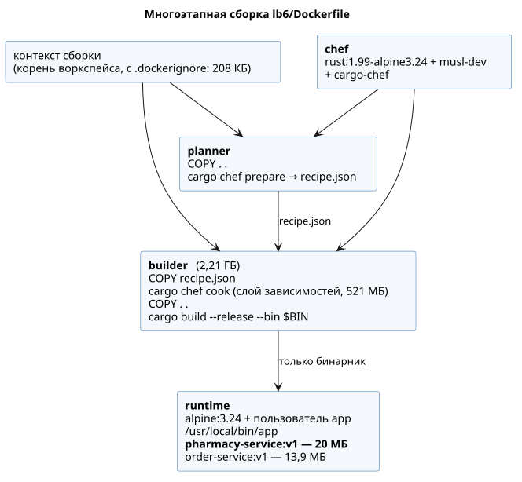
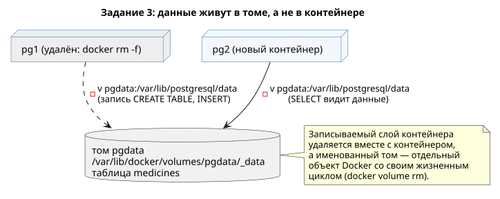
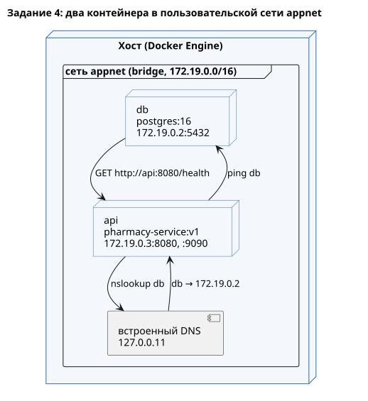
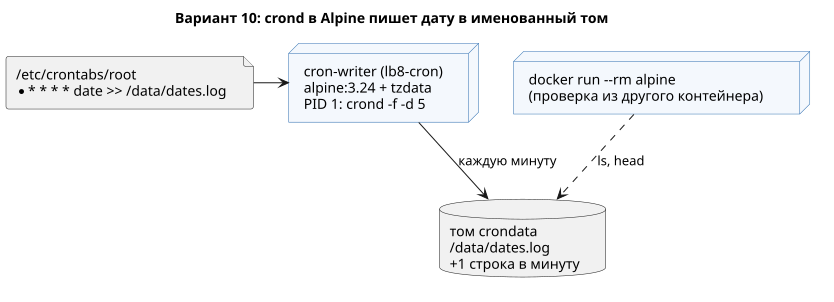

**Имя студента:** Цароев Альберт Казебкович\
**Группа:** ПИЖ-б-о-23-1(1)\
**Предмет:** Контейнерные технологии и DevOps для ИТ-специалистов\
**Претендую на оценку:** Отлично

# Лабораторная работа №8. Основы Docker

## Цель работы

Изучить принципы работы Docker, освоить управление контейнерами, портами,
томами и сетями, научиться запускать готовые образы и подготавливать
собственный сервис к контейнеризации.

## Задание

1. **Базовое.** Выполнить шаги практической части: `docker version`,
   `docker run hello-world`, `docker images` после `docker pull nginx`,
   `docker ps` и `docker logs my-nginx`, `curl http://localhost:8080`,
   `docker exec web hostname`, `docker volume inspect pgdata`,
   `docker network inspect mynet`, `docker system df` до и после очистки.
2. **Свой микросервис в Docker.** Собрать образ сервиса из ЛР 6, запустить
   контейнер и проверить эндпоинты; создать `.dockerignore` и сравнить размер
   образа до и после.
3. **PostgreSQL с томом.** Запустить `postgres:16` с named volume, создать
   таблицу, удалить контейнер, запустить новый с тем же томом, убедиться, что
   таблица сохранилась, и объяснить почему.
4. **Связка двух контейнеров.** Сеть `appnet`, контейнеры `db` (postgres) и
   `api` (наш сервис), проверка `docker exec api ping db`.
5. **Docker Hub.** Публичный репозиторий `order-service`, `docker login`,
   `docker tag` и `docker push`, затем `docker pull` и запуск после `docker rmi`.

**Вариант 10. Cron-задача:** контейнер `alpine` с `crond`, который каждую
минуту пишет дату в файл на named volume; убедиться, что файл растёт.

## Ход работы

Все команды оформлены скриптами в `lb8/scripts/`, их можно запускать
повторно из корня воркспейса. Функция `run` печатает каждую команду перед
выполнением, поэтому вывод скриптов совпадает с выводом терминала.

```text
lb8/
├── cron/                    — вариант 10: Dockerfile и crontab
├── docs/                    — диаграммы
└── scripts/
    ├── lib.sh               — общие функции (run, wait_for)
    ├── task1_basics.sh      — задание 1
    ├── task1_cleanup.sh     — задание 1: docker system df до и после очистки
    ├── task2_service.sh     — задание 2
    ├── task3_postgres.sh    — задание 3
    ├── task4_network.sh     — задание 4
    ├── task5_dockerhub.sh   — задание 5
    └── variant10_check.sh   — вариант 10
```

Docker Engine на машине установлен из пакетов Ubuntu без плагина buildx,
поэтому `docker build` использует классический builder (он выводит
предупреждение `DEPRECATED: The legacy builder…`). Dockerfile из ЛР 6
намеренно не использует возможностей, специфичных для BuildKit, и одинаково
собирается и здесь, и в GitHub Actions (buildx).

### Задание 1. Базовые команды

```bash
$ docker version
Client:
 Version:           29.1.3
 API version:       1.52
 Go version:        go1.24.13
 Git commit:        29.1.3-0ubuntu4.1
 Built:             Wed Apr 29 16:40:20 2026
 OS/Arch:           linux/amd64
 Context:           default

Server:
 Engine:
  Version:          29.1.3
  API version:      1.52 (minimum version 1.44)
  Go version:       go1.24.13
  Git commit:       29.1.3-0ubuntu4.1
  Built:            Wed Apr 29 16:40:20 2026
  OS/Arch:          linux/amd64
  Experimental:     false
 containerd:
  Version:          2.2.2
 runc:
  Version:          1.4.0-0ubuntu1
 docker-init:
  Version:          0.19.0
```

`docker version` показывает две части: клиент (CLI) и сервер (демон
`dockerd`), которые общаются через REST API (версия 1.52). Контейнеры
фактически запускает `containerd` с низкоуровневым рантаймом `runc`.

```bash
$ docker run hello-world

Hello from Docker!
This message shows that your installation appears to be working correctly.

To generate this message, Docker took the following steps:
 1. The Docker client contacted the Docker daemon.
 2. The Docker daemon pulled the "hello-world" image from the Docker Hub.
    (amd64)
 3. The Docker daemon created a new container from that image which runs the
    executable that produces the output you are currently reading.
 4. The Docker daemon streamed that output to the Docker client, which sent it
    to your terminal.
…
```

```bash
$ docker pull nginx
Using default tag: latest
latest: Pulling from library/nginx
f2be67225471: Pulling fs layer
24bf03b6a474: Pulling fs layer
…
a856bfc2a772: Pull complete
Digest: sha256:4c41e2d0a3a55b325ed572cd0200bdb72af1433c3daa2bca6ef8eea68ce504a2
Status: Downloaded newer image for nginx:latest
docker.io/library/nginx:latest

$ docker images
IMAGE                            ID             DISK USAGE   CONTENT SIZE   EXTRA
alpine:3.24                      71e9b7bae160         13MB         3.94MB
hello-world:latest               0e760fdfbc48       25.9kB         9.49kB   U
lb8-cron:latest                  ab48bc3ccf66       14.8MB         4.03MB   U
mongo:7                          4b5bf3c2bb75       1.19GB          296MB
nginx:latest                     4c41e2d0a3a5        243MB         66.8MB
pharmacy-service:v1              8747ba215cca         20MB         5.87MB
plantuml/plantuml-server:jetty   065c66adc672       1.23GB          445MB   U
rhysd/actionlint:1.7.12          b1934ee5f1c5        102MB         25.3MB
rust:1.99-alpine3.24             3ea887915f26       1.39GB          353MB
```

Образ скачивается слоями; одинаковые слои разных образов хранятся один раз.
В Docker 29 `docker images` показывает и размер на диске (распакованный), и
размер содержимого (сжатого при передаче), а флаг `U` (in use) помечает образы
с запущенными контейнерами.

```bash
$ docker run -d --name my-nginx -p 8080:80 nginx
197d3ae21e94f47a12732c16922e4b2aee749baf9e57d67e62603384d790d7eb

$ docker ps
CONTAINER ID   IMAGE      COMMAND                  CREATED                  STATUS                  PORTS                                     NAMES
197d3ae21e94   nginx      "/docker-entrypoint.…"   Less than a second ago   Up Less than a second   0.0.0.0:8080->80/tcp, [::]:8080->80/tcp   my-nginx

$ curl -s http://localhost:8080
<!DOCTYPE html>
<html>
<head>
<title>Welcome to nginx!</title>
…
<h1>Welcome to nginx!</h1>
<p>If you see this page, nginx is successfully installed and working.
…
<p><em>Thank you for using nginx.</em></p>
</body>
</html>

$ docker logs my-nginx
/docker-entrypoint.sh: /docker-entrypoint.d/ is not empty, will attempt to perform configuration
/docker-entrypoint.sh: Looking for shell scripts in /docker-entrypoint.d/
/docker-entrypoint.sh: Launching /docker-entrypoint.d/10-listen-on-ipv6-by-default.sh
…
/docker-entrypoint.sh: Configuration complete; ready for start up
2026/10/22 05:58:07 [notice] 1#1: using the "epoll" event method
2026/10/22 05:58:07 [notice] 1#1: nginx/1.31.8
2026/10/22 05:58:07 [notice] 1#1: start worker processes
…
172.17.0.1 - - [22/Oct/2026:05:58:07 +0000] "GET / HTTP/1.1" 200 896 "-" "curl/8.18.0" "-"
```

`-d` запускает контейнер в фоне, `-p 8080:80` публикует порт 80 контейнера на
порт 8080 хоста. `docker logs` показывает stdout/stderr главного процесса
контейнера; последняя строка — наш запрос curl, пришедший с адреса шлюза
bridge-сети `172.17.0.1`.

```bash
$ docker network create mynet
b40692a07dec638d040808585b1e0d732a0430c92091adbf01ecf9a689c8a9c7

$ docker run -d --name web --network mynet nginx
82b0fe6c7e9d0f5f566185c785f93a73ad9ffa353780c14ec79e4d6745842960

$ docker exec web hostname
82b0fe6c7e9d
```

`docker exec` выполняет команду внутри уже работающего контейнера. Имя хоста
контейнера по умолчанию — первые 12 символов его ID.

```bash
$ docker volume create pgdata
pgdata

$ docker volume inspect pgdata
[
    {
        "CreatedAt": "2026-10-22T08:58:08+03:00",
        "Driver": "local",
        "Labels": null,
        "Mountpoint": "/var/lib/docker/volumes/pgdata/_data",
        "Name": "pgdata",
        "Options": null,
        "Scope": "local"
    }
]

$ docker network inspect mynet
[
    {
        "Name": "mynet",
        "Id": "b40692a07dec638d040808585b1e0d732a0430c92091adbf01ecf9a689c8a9c7",
        "Created": "2026-10-22T08:58:07.881690392+03:00",
        "Scope": "local",
        "Driver": "bridge",
        "EnableIPv4": true,
        "EnableIPv6": false,
        "IPAM": {
            "Driver": "default",
            "Options": {},
            "Config": [
                {
                    "Subnet": "172.19.0.0/16",
                    "IPRange": "",
                    "Gateway": "172.19.0.1"
                }
            ]
        },
        "Internal": false,
        …
        "Containers": {
            "82b0fe6c7e9d0f5f566185c785f93a73ad9ffa353780c14ec79e4d6745842960": {
                "Name": "web",
                "EndpointID": "edf134449d5086a3ebdfbe890aa76f799eaa0348b683b086c212a462b4843e77",
                "MacAddress": "2e:82:2c:36:06:a7",
                "IPv4Address": "172.19.0.2/16",
                "IPv6Address": ""
            }
        },
        …
    }
]
```

Том — каталог, которым управляет Docker (`Mountpoint` на хосте). Сеть `mynet` —
отдельный bridge с собственной подсетью `172.19.0.0/16`; контейнер `web`
получил в ней адрес `172.19.0.2`.

**Очистка.** На рабочей машине есть посторонние образы и тома с данными
(например, `mongo`), поэтому вместо `docker system prune` удалены только
объекты, созданные в задании (скрипт `task1_cleanup.sh`):

```bash
$ docker system df
TYPE            TOTAL     ACTIVE    SIZE      RECLAIMABLE
Images          11        4         5.087GB   1.97GB (38%)
Containers      5         3         102.6MB   102.4MB (99%)
Local Volumes   13        2         1.18GB    1.18GB (99%)
Build Cache     0         0         0B        0B

$ docker rm -f my-nginx web
$ docker rm 0d43eb59d1a5            # остановленный контейнер hello-world
$ docker network rm mynet
$ docker volume rm pgdata
$ docker rmi nginx
$ docker image prune -f             # «висячие» образы промежуточных стадий сборки
Deleted Images:
…
Total reclaimed space: 191.9MB

$ docker system df
TYPE            TOTAL     ACTIVE    SIZE      RECLAIMABLE
Images          8         2         4.025GB   1.34GB (33%)
Containers      2         1         102.4MB   102.4MB (99%)
Local Volumes   12        2         1.18GB    1.18GB (99%)
Build Cache     0         0         0B        0B
```

Занятое образами место уменьшилось на ≈1,06 ГБ (5,087 → 4,025 ГБ), контейнеров
стало 2 вместо 5. `RECLAIMABLE` — объём, который можно освободить, не трогая
используемые объекты. Оставшиеся 1,18 ГБ томов принадлежат другим проектам,
поэтому намеренно не удалялись (`docker volume prune` уничтожил бы их данные).

### Задание 2. Свой микросервис в Docker

Образ собирается по `lb6/Dockerfile` (подробно описан в ЛР 7). Контекст
сборки — корень воркспейса.



```bash
$ docker build -f lb6/Dockerfile -t pharmacy-service:v1 .
Sending build context to Docker daemon  208.9kB
Step 1/22 : ARG RUST_IMAGE=rust:1.99-alpine3.24
Step 2/22 : ARG RUNTIME_IMAGE=alpine:3.24
Step 3/22 : FROM ${RUST_IMAGE} AS chef
Step 4/22 : RUN apk add --no-cache musl-dev  && cargo install cargo-chef --locked --version 0.1.78
Step 5/22 : WORKDIR /src
Step 6/22 : FROM chef AS planner
Step 7/22 : COPY . .
Step 8/22 : RUN cargo chef prepare --recipe-path recipe.json
Step 9/22 : FROM chef AS builder
Step 10/22 : COPY --from=planner /src/recipe.json recipe.json
Step 11/22 : RUN cargo chef cook --release --locked -p lb6 --recipe-path recipe.json
Step 12/22 : COPY . .
Step 13/22 : ARG BIN=pharmacy
Step 14/22 : RUN cargo build --release --locked -p lb6 --bin "${BIN}"  && cp "target/release/${BIN}" /usr/local/bin/app
Step 15/22 : FROM ${RUNTIME_IMAGE}
Step 16/22 : ARG BIN=pharmacy
Step 17/22 : LABEL org.opencontainers.image.title="${BIN}" …
Step 18/22 : RUN addgroup -S app && adduser -S -G app app
Step 19/22 : COPY --from=builder /usr/local/bin/app /usr/local/bin/app
Step 20/22 : USER app
Step 21/22 : EXPOSE 8080 9090
Step 22/22 : ENTRYPOINT ["/usr/local/bin/app"]
Successfully built 787ee4c068a3
Successfully tagged pharmacy-service:v1

$ docker images pharmacy-service
IMAGE                 ID             DISK USAGE   CONTENT SIZE   EXTRA
pharmacy-service:v1   787ee4c068a3         20MB         5.87MB
```

Запуск и проверка эндпоинтов (HTTP на 8080, gRPC на 9090):

```bash
$ docker run -d --name pharmacy -p 8080:8080 -p 9090:9090 pharmacy-service:v1
6c7fc74a8993f9bcde2696c947462a18a6a17c10e5bd94334dd7c7a37330bc64

$ docker ps --filter name=pharmacy
CONTAINER ID   IMAGE                 COMMAND                CREATED        STATUS                  PORTS                                                                                      NAMES
6c7fc74a8993   pharmacy-service:v1   "/usr/local/bin/app"   1 second ago   Up Less than a second   0.0.0.0:8080->8080/tcp, [::]:8080->8080/tcp, 0.0.0.0:9090->9090/tcp, [::]:9090->9090/tcp   pharmacy

$ curl -s http://localhost:8080/health
{"status":"ok"}
$ curl -s -X POST http://localhost:8080/medicines -H 'Content-Type: application/json' -d '{"id":"asp-500","name":"Аспирин","manufacturer":"Bayer","price":120.5,"prescription":false,"quantity":30}'
{"id":"asp-500"}
$ curl -s -i -X POST http://localhost:8080/medicines/asp-500/sell -H 'Content-Type: application/json' -d '{"count":12}'
HTTP/1.1 204 No Content
date: Thu, 22 Oct 2026 06:23:57 GMT

$ curl -s http://localhost:8080/medicines/asp-500
{"id":"asp-500","name":"Аспирин","manufacturer":"Bayer","price":120.5,"prescription":false,"quantity":18}
$ curl -s -i http://localhost:8080/medicines/unknown
HTTP/1.1 404 Not Found
content-type: application/json
content-length: 58
date: Thu, 22 Oct 2026 06:23:57 GMT

{"error":"лекарство unknown не найдено"}
$ grpcurl -plaintext -d '{"id":"asp-500"}' localhost:9090 pharmacy.v1.Pharmacy/GetByID
{
  "medicine": {
    "id": "asp-500",
    "name": "Аспирин",
    "manufacturer": "Bayer",
    "price": 120.5,
    "quantity": 18
  }
}

$ docker exec pharmacy id
uid=100(app) gid=101(app) groups=101(app)

$ docker stop pharmacy
pharmacy

$ docker logs pharmacy
2026-10-22T06:23:57.102479Z  INFO pharmacy: HTTP-транспорт слушает http://0.0.0.0:8080
2026-10-22T06:23:57.102496Z  INFO pharmacy: gRPC-транспорт слушает 0.0.0.0:9090
2026-10-22T06:23:57.140823Z  INFO lb6::pharmacy::service: ok method="create" args="Аспирин" took=2.349µs
2026-10-22T06:23:57.147094Z  INFO lb6::pharmacy::service: ok method="sell" args=("asp-500", 12) took=833ns
2026-10-22T06:23:57.152284Z  INFO lb6::pharmacy::service: ok method="get_by_id" args="asp-500" took=1.079µs
2026-10-22T06:23:57.158299Z  WARN lb6::pharmacy::service: error method="get_by_id" args="unknown" took=661ns err=лекарство unknown не найдено
2026-10-22T06:23:57.169279Z  INFO lb6::pharmacy::service: ok method="get_by_id" args="asp-500" took=925ns
2026-10-22T06:23:57.276154Z  INFO pharmacy: получен сигнал завершения, останавливаем серверы
2026-10-22T06:23:57.276265Z  INFO pharmacy: серверы остановлены
```

Процесс в контейнере работает от непривилегированного пользователя `app`, а не
от root. По `docker stop` сервис получил SIGTERM и корректно завершился за
≈0,1 с, не дожидаясь принудительного `SIGKILL` через 10 секунд, — это
обеспечивает обработчик сигнала в `main` (ЛР 6). Логи пишутся без
ANSI-цветов: сервис включает цвета, только если stdout — терминал.

**.dockerignore.** Файл лежит в корне воркспейса (корень контекста сборки):

```text
# Артефакты сборки cargo: гигабайты, которые пересобираются внутри образа
target/
**/target/

# Git и CI
.git/
.github/
.gitignore

# Отчёты, диаграммы и инструменты, не нужные для сборки
**/*.md
**/*.pdf
**/docs/
tools/
lb5/
lb7/
lb8/

# Локальные файлы редакторов и окружения
.vscode/
.idea/
.venv/
*.log
*.tmp
```

Для сравнения образ собран дважды: с временно убранным `.dockerignore` и с
ним. Сохранялась и стадия `builder` (`--target builder`), чтобы увидеть, куда
попадают лишние файлы:

```bash
$ du -sh target
2.4G	target

# без .dockerignore
$ docker build -f lb6/Dockerfile --target builder -t pharmacy-builder:no-dockerignore .
Sending build context to Docker daemon  2.503GB
$ docker build -f lb6/Dockerfile -t pharmacy-service:no-dockerignore .
Sending build context to Docker daemon  2.804GB

# с .dockerignore
$ docker build -f lb6/Dockerfile --target builder -t pharmacy-builder:with-dockerignore .
Sending build context to Docker daemon  208.4kB

$ docker images --format "table {{.Repository}}:{{.Tag}}\t{{.Size}}" | grep -E "pharmacy|order"
REPOSITORY:TAG                       SIZE
pharmacy-service:no-dockerignore     20MB
pharmacy-service:v1                  20MB
pharmacy-builder:no-dockerignore     5.47GB
pharmacy-builder:with-dockerignore   2.21GB

$ docker history --format '{{.Size}}\t{{.CreatedBy}}' pharmacy-builder:with-dockerignore | grep -E 'COPY|cargo'
24MB    cargo build --release --locked -p lb6 --bin "${BIN}" && cp …
377kB   COPY dir:15dcd466a0e0… in .
521MB   cargo chef cook --release --locked -p lb6 --recipe-path recipe.json
61.4kB  COPY file:c671d8fd6b83… in recipe.json
79.7MB  apk add --no-cache musl-dev && cargo install cargo-chef --locked --version 0.1.78

$ docker history --format '{{.Size}}\t{{.CreatedBy}}' pharmacy-builder:no-dockerignore | grep -E 'COPY|cargo'
24.1MB  cargo build --release --locked -p lb6 --bin "${BIN}" && cp …
2.52GB  COPY dir:5731876abc4d… in .
521MB   cargo chef cook --release --locked -p lb6 --recipe-path recipe.json
61.4kB  COPY file:c671d8fd6b83… in recipe.json
79.7MB  apk add --no-cache musl-dev && cargo install cargo-chef --locked --version 0.1.78
```

| Показатель                          | без .dockerignore | с .dockerignore |
|-------------------------------------|------------------:|----------------:|
| контекст, отправляемый демону       | 2,50 ГБ           | 208 КБ          |
| слой `COPY . .` в стадии builder    | 2,52 ГБ           | 377 КБ          |
| образ стадии builder                | 5,47 ГБ           | 2,21 ГБ         |
| **итоговый образ**                  | **20 МБ**         | **20 МБ**       |

**Почему итоговый размер одинаковый.** Сборка многоэтапная: в финальный образ
из стадии `builder` копируется только бинарник
(`COPY --from=builder /usr/local/bin/app`), поэтому всё лишнее, что попало в
контекст, остаётся в промежуточной стадии и в итоговый образ не попадает. Без
`.dockerignore` в контекст уходит каталог `target/` (2,4 ГБ локальных
артефактов cargo), `.git` и документация. Это даёт:

* передачу 2,5 ГБ демону при каждой сборке (вместо 208 КБ) — сборка
  медленнее, а в CI ещё и дольше загружается контекст;
* слой `COPY . .` на 2,52 ГБ в стадии `builder`, которая хранится как кэш
  сборки и занимает диск;
* инвалидацию кэша: любой локальный `cargo build` меняет `target/`, а значит и
  контекст, и шаги `COPY . .` пересобираются, даже если исходники не менялись;
* риск утечки в образ того, что не должно туда попасть (`.git`, локальные
  файлы с секретами).

В одноэтапной сборке (`FROM rust … COPY . . … CMD`) лишние 2,5 ГБ оказались бы
и в итоговом образе, поэтому `.dockerignore` нужен в любом случае.

### Задание 3. PostgreSQL с томом



```bash
$ docker volume create pgdata
pgdata

$ docker run -d --name pg1 -e POSTGRES_PASSWORD=lab8 -v pgdata:/var/lib/postgresql/data postgres:16
c5a455afc982586065819a6e942bfb377702aa5b35c8c6097e068a16f8399804

$ docker exec pg1 psql -U postgres -c "CREATE TABLE medicines (id serial PRIMARY KEY, name text NOT NULL, quantity int NOT NULL);"
CREATE TABLE

$ docker exec pg1 psql -U postgres -c "INSERT INTO medicines (name, quantity) VALUES ('Парацетамол', 100), ('Ибупрофен', 40);"
INSERT 0 2

$ docker exec pg1 psql -U postgres -c "SELECT * FROM medicines;"
 id |    name     | quantity
----+-------------+----------
  1 | Парацетамол |      100
  2 | Ибупрофен   |       40
(2 rows)

$ docker rm -f pg1
pg1

$ docker ps -a --filter name=pg1
CONTAINER ID   IMAGE     COMMAND   CREATED   STATUS    PORTS     NAMES

$ docker volume ls --filter name=pgdata
DRIVER    VOLUME NAME
local     pgdata

$ docker run -d --name pg2 -e POSTGRES_PASSWORD=lab8 -v pgdata:/var/lib/postgresql/data postgres:16
82e00b574ca1931570dd0e622339ee73e1178dc3fe3a5ee8cf3f31a4122e8218

$ docker exec pg2 psql -U postgres -c '\dt'
           List of relations
 Schema |   Name    | Type  |  Owner
--------+-----------+-------+----------
 public | medicines | table | postgres
(1 row)

$ docker exec pg2 psql -U postgres -c "SELECT * FROM medicines;"
 id |    name     | quantity
----+-------------+----------
  1 | Парацетамол |      100
  2 | Ибупрофен   |       40
(2 rows)

$ docker volume inspect pgdata
[
    {
        "CreatedAt": "2026-10-22T09:07:23+03:00",
        "Driver": "local",
        "Labels": null,
        "Mountpoint": "/var/lib/docker/volumes/pgdata/_data",
        "Name": "pgdata",
        "Options": null,
        "Scope": "local"
    }
]
```

Скрипт ждёт готовности сервера командой `pg_isready -h 127.0.0.1`: при первом
запуске образ postgres инициализирует кластер на временном сервере, который
слушает только unix-сокет, а затем перезапускается. Проверка по TCP отличает
«настоящий» сервер от временного.

**Почему данные не потерялись.** Файловая система контейнера состоит из слоёв
образа (только чтение) и тонкого записываемого слоя, который принадлежит
контейнеру и удаляется вместе с ним (`docker rm`). Каталог данных PostgreSQL
`/var/lib/postgresql/data` был смонтирован из именованного тома `pgdata`, а том —
отдельный объект Docker со своим жизненным циклом (хранится в
`/var/lib/docker/volumes/pgdata/_data`). Поэтому все записи таблицы оказались
на томе, а не в слое контейнера. Удаление контейнера том не затрагивает, а новый
контейнер, подключивший тот же том, видит существующий кластер (инициализация
пропускается, так как каталог не пуст) вместе с таблицей. Том удаляется
только явно: `docker volume rm pgdata` или `docker rm -v` для анонимных томов.

### Задание 4. Связка двух контейнеров



```bash
$ docker network create appnet
d2691ec5c6e6ce0b03a2e0a4ac47e32782df7443816f8221051b3de688bb6d2f

$ docker run -d --name db --network appnet -e POSTGRES_PASSWORD=lab8 postgres:16
eeaa320048a87d51ebd2bcb30e0f27f705fcf026e5a3943a3c79109dc2be780f

$ docker run -d --name api --network appnet pharmacy-service:v1
da9f916f379fa9a879da37b027e868a0b29eef65732e7b17623d13aa7c3d6dff

$ docker ps --filter network=appnet
CONTAINER ID   IMAGE                 COMMAND                  CREATED                  STATUS                  PORTS                NAMES
da9f916f379f   pharmacy-service:v1   "/usr/local/bin/app"     Less than a second ago   Up Less than a second   8080/tcp, 9090/tcp   api
eeaa320048a8   postgres:16           "docker-entrypoint.s…"   1 second ago             Up Less than a second   5432/tcp             db

$ docker exec api ping -c 3 db
PING db (172.19.0.2): 56 data bytes
64 bytes from 172.19.0.2: seq=0 ttl=42 time=0.066 ms
64 bytes from 172.19.0.2: seq=1 ttl=42 time=0.045 ms
64 bytes from 172.19.0.2: seq=2 ttl=42 time=0.066 ms

--- db ping statistics ---
3 packets transmitted, 3 packets received, 0% packet loss
round-trip min/avg/max = 0.045/0.059/0.066 ms

$ docker exec api nslookup db
Server:		127.0.0.11
Address:	127.0.0.11:53

Non-authoritative answer:
Name:	db
Address: 172.19.0.2

$ docker exec api cat /etc/resolv.conf
# Generated by Docker Engine.
…
nameserver 127.0.0.11
search .
options edns0 trust-ad ndots:0

$ docker exec db bash -c 'exec 3<>/dev/tcp/api/8080; printf "GET /health HTTP/1.1\r\nHost: api\r\nConnection: close\r\n\r\n" >&3; cat <&3'
HTTP/1.1 200 OK
content-type: application/json
content-length: 15
connection: close
date: Thu, 22 Oct 2026 06:07:42 GMT

{"status":"ok"}

$ docker network inspect appnet --format '{{range .Containers}}{{.Name}} {{.IPv4Address}}{{"\n"}}{{end}}'
api 172.19.0.3/16
db 172.19.0.2/16

$ docker rm -f api db
$ docker network rm appnet
```

В пользовательской сети Docker запускает встроенный DNS-сервер `127.0.0.11`
(он прописан в `/etc/resolv.conf` контейнера), который разрешает имена
контейнеров этой сети в их IP-адреса. Поэтому `api` обращается к базе по имени
`db` и не зависит от того, какой IP достался контейнеру при запуске. Обратная
проверка — HTTP-запрос из `db` к `http://api:8080/health` — подтверждает связь
в обе стороны. В стандартной сети `bridge` такого разрешения имён нет. Образ
нашего сервиса основан на Alpine, поэтому `ping` и `nslookup` (из busybox)
доступны в нём без установки дополнительных пакетов. Порты `api` и `db` наружу
не публиковались: контейнеры общаются внутри сети напрямую.

### Задание 5. Docker Hub

Для публикации подготовлен образ `order-service:v1` — сервис заказов из задания 1
ЛР 6, собранный тем же Dockerfile с другим бинарником. Благодаря слою
зависимостей `cargo chef` и тому, что `ARG BIN` объявлен после него, сборка
второго сервиса заняла 14 секунд:

```bash
$ docker build -f lb6/Dockerfile --build-arg BIN=orders -t order-service:v1 .
Sending build context to Docker daemon  208.9kB
Successfully tagged order-service:v1
real	0m13,986s

$ docker images order-service
IMAGE              ID             DISK USAGE   CONTENT SIZE   EXTRA
order-service:v1   e519a2c1f446       13.9MB         4.17MB
```

Публикация, удаление локальных копий (имитация «другой машины»), скачивание
из Docker Hub и запуск на порту 8082 (скрипт `task5_dockerhub.sh`):

```bash
$ docker login
Authenticating with existing credentials... [Username: wildcat2k21]
Login Succeeded

$ docker tag order-service:v1 wildcat2k21/order-service:v1

$ docker images order-service
IMAGE              ID             DISK USAGE   CONTENT SIZE   EXTRA
order-service:v1   e519a2c1f446       13.9MB         4.17MB

$ docker images wildcat2k21/order-service
IMAGE                          ID             DISK USAGE   CONTENT SIZE   EXTRA
wildcat2k21/order-service:v1   e519a2c1f446       13.9MB         4.17MB

$ docker push wildcat2k21/order-service:v1
The push refers to repository [docker.io/wildcat2k21/order-service]
…
7b229517ed22: Mounted from library/alpine
f47c27967466: Pushed
27b301cd31d7: Pushed
v1: digest: sha256:e519a2c1f44687711b4f82ec8020591d2f92d19dd1665f6efb7792e98650d3c3 size: 968

$ docker rmi wildcat2k21/order-service:v1 order-service:v1
Untagged: wildcat2k21/order-service:v1
Untagged: order-service:v1
Deleted: sha256:e519a2c1f44687711b4f82ec8020591d2f92d19dd1665f6efb7792e98650d3c3

$ docker images --filter 'reference=*order-service*'
IMAGE   ID             DISK USAGE   CONTENT SIZE   EXTRA

$ docker pull wildcat2k21/order-service:v1
v1: Pulling from wildcat2k21/order-service
27b301cd31d7: Pulling fs layer
f47c27967466: Pulling fs layer
f47c27967466: Download complete
f47c27967466: Pull complete
27b301cd31d7: Download complete
27b301cd31d7: Pull complete
Digest: sha256:e519a2c1f44687711b4f82ec8020591d2f92d19dd1665f6efb7792e98650d3c3
Status: Downloaded newer image for wildcat2k21/order-service:v1
docker.io/wildcat2k21/order-service:v1

$ docker run -d --rm --name order-service -p 8082:8080 wildcat2k21/order-service:v1
1b3031c268e8ae6de5a42a697c36341b96aec79c5f979176e0b7fb736f34a468

$ docker ps --filter name=order-service
CONTAINER ID   IMAGE                          COMMAND                CREATED                  STATUS                  PORTS                                                   NAMES
1b3031c268e8   wildcat2k21/order-service:v1   "/usr/local/bin/app"   Less than a second ago   Up Less than a second   9090/tcp, 0.0.0.0:8082->8080/tcp, [::]:8082->8080/tcp   order-service

$ curl -s -X POST http://localhost:8082/orders -H 'Content-Type: application/json' -d '{"customer":"Альберт","item":"Ноутбук","quantity":1}'
{"id":1,"customer":"Альберт","item":"Ноутбук","quantity":1}
$ curl -s http://localhost:8082/orders/1
{"id":1,"customer":"Альберт","item":"Ноутбук","quantity":1}
$ curl -s http://localhost:8082/orders
[{"id":1,"customer":"Альберт","item":"Ноутбук","quantity":1}]
$ docker logs order-service
order-service слушает http://0.0.0.0:8080
GET /orders -> 200
POST /orders -> 201
GET /orders/1 -> 200
GET /orders -> 200

$ docker stop order-service
order-service
```

Репозиторий создан автоматически при первом `docker push` и доступен публично:
<https://hub.docker.com/r/wildcat2k21/order-service>. Слой `7b229517ed22`
(базовый Alpine) не загружался: `Mounted from library/alpine`. Docker Hub
подключил уже имеющийся у него слой официального образа, поэтому передавались
только два собственных слоя (пользователь `app` и бинарник). После `docker rmi`
локальных копий не осталось, и `docker pull` скачал образ по тому же дайджесту
`sha256:e519a2c1…`: это тот же самый образ, что был собран локально.

### Вариант 10. Cron-задача в Alpine



```dockerfile
FROM alpine:3.24

# busybox crond уже есть в базовом образе; tzdata нужен для местного времени.
RUN apk add --no-cache tzdata
ENV TZ=Europe/Moscow

COPY crontab /etc/crontabs/root

VOLUME /data

# -f — на переднем плане (PID 1 контейнера), -d 5 — лог в stderr (виден в
# `docker logs`) с уровнем, при котором записывается каждый запуск задания.
CMD ["crond", "-f", "-d", "5"]
```

```text
# мин час день месяц день_недели команда
* * * * * date '+%Y-%m-%d %H:%M:%S %Z' >> /data/dates.log
```

`crond` в Alpine входит в busybox, поэтому дополнительно устанавливается только
`tzdata`. Демон запускается на переднем плане (`-f`) и становится PID 1
контейнера: если запустить его в фоне, главный процесс завершится, и контейнер
сразу остановится.

```bash
$ docker build -t lb8-cron lb8/cron
…
Successfully tagged lb8-cron:latest

$ docker volume create crondata
crondata

$ docker run -d --name cron-writer -v crondata:/data lb8-cron
f35563831f5e737144caa8861e18b6a334f07f3977a075fb51c7a151cfce6120
```

Первая версия образа запускала `crond -f -l 2`, и `docker logs` оставался пустым:
ключ `-l` лишь задаёт уровень, а пишет в syslog. После замены на `-d 5`
(лог в stderr) контейнер пересоздан на **том же томе**. Файл продолжил расти с
38-й строки, что дополнительно подтверждает независимость данных тома от
контейнера:

```bash
$ docker rm -f cron-writer
$ docker run -d --name cron-writer -v crondata:/data lb8-cron
20eadbbe0c9b99f68ace248ec8b2be672d538962c42ee2bce3bec6c9b89dc658

$ docker exec cron-writer wc -l /data/dates.log
38 /data/dates.log

$ docker exec cron-writer tail -n 3 /data/dates.log
2026-10-22 09:17:00 MSK
2026-10-22 09:18:00 MSK
2026-10-22 09:19:00 MSK

... ждём 125 секунд ...

$ docker exec cron-writer wc -l /data/dates.log
40 /data/dates.log

$ docker exec cron-writer tail -n 3 /data/dates.log
2026-10-22 09:19:00 MSK
2026-10-22 09:20:00 MSK
2026-10-22 09:21:00 MSK

$ docker run --rm -v crondata:/data alpine:3.24 sh -c 'ls -l /data && head -n 3 /data/dates.log'
total 4
-rw-r--r--    1 root     root           960 Oct 22 06:21 dates.log
2026-10-22 08:41:00 MSK
2026-10-22 08:42:00 MSK
2026-10-22 08:43:00 MSK

$ docker logs --tail 4 cron-writer
crond:  job: 0 date '+%Y-%m-%d %H:%M:%S %Z' >> /data/dates.log
crond: child running /bin/sh
crond: USER root pid  32 cmd date '+%Y-%m-%d %H:%M:%S %Z' >> /data/dates.log
crond: wakeup dt=10
```

Файл растёт на одну строку в минуту (38 → 40 за две минуты), первая запись
сделана в 08:41 — через несколько секунд после первого запуска контейнера.
Файл виден из другого контейнера, подключившего тот же том.

## Результаты

| Задание | Результат |
|---------|-----------|
| 1 | выполнены все команды практической части; очистка удалила только созданные объекты (−1,06 ГБ образов, −3 контейнера) |
| 2 | образ `pharmacy-service:v1` — 20 МБ, контейнер отвечает по HTTP и gRPC, работает не от root, корректно останавливается; `.dockerignore` уменьшил контекст с 2,5 ГБ до 208 КБ |
| 3 | таблица `medicines` пережила удаление контейнера благодаря тому `pgdata` |
| 4 | `api` разрешает имя `db` через DNS 127.0.0.11, ping и HTTP проходят в обе стороны |
| 5 | `wildcat2k21/order-service:v1` (13,9 МБ) опубликован в Docker Hub, скачан заново и запущен на порту 8082 |
| вариант 10 | `crond` пишет дату в том `crondata` каждую минуту, файл растёт |

## Вывод

В работе освоены основные объекты Docker и их жизненные циклы: образы
(слоистые, неизменяемые), контейнеры (запускаемые экземпляры с тонким
записываемым слоем), тома (постоянные данные вне контейнера) и пользовательские
сети (изоляция и разрешение имён через встроенный DNS).

Сервис из ЛР 6 упакован в образ на 20 МБ с помощью многоэтапной сборки:
компилятор и зависимости остаются в промежуточных стадиях, а в итоговый образ
попадает только статический бинарник на Alpine. Эксперимент с `.dockerignore`
показал, что в многоэтапной сборке он почти не влияет на итоговый размер, но
радикально сокращает контекст (2,5 ГБ → 208 КБ), размер промежуточных слоёв и
время сборки, а также защищает от случайного попадания в образ лишних файлов.

Задания с PostgreSQL и cron на практике показали главное правило работы с
данными в Docker: всё, что должно пережить контейнер, хранится в томе. Очистку
на машине с чужими данными следует выполнять адресно, а не через
`docker system prune --volumes`.
